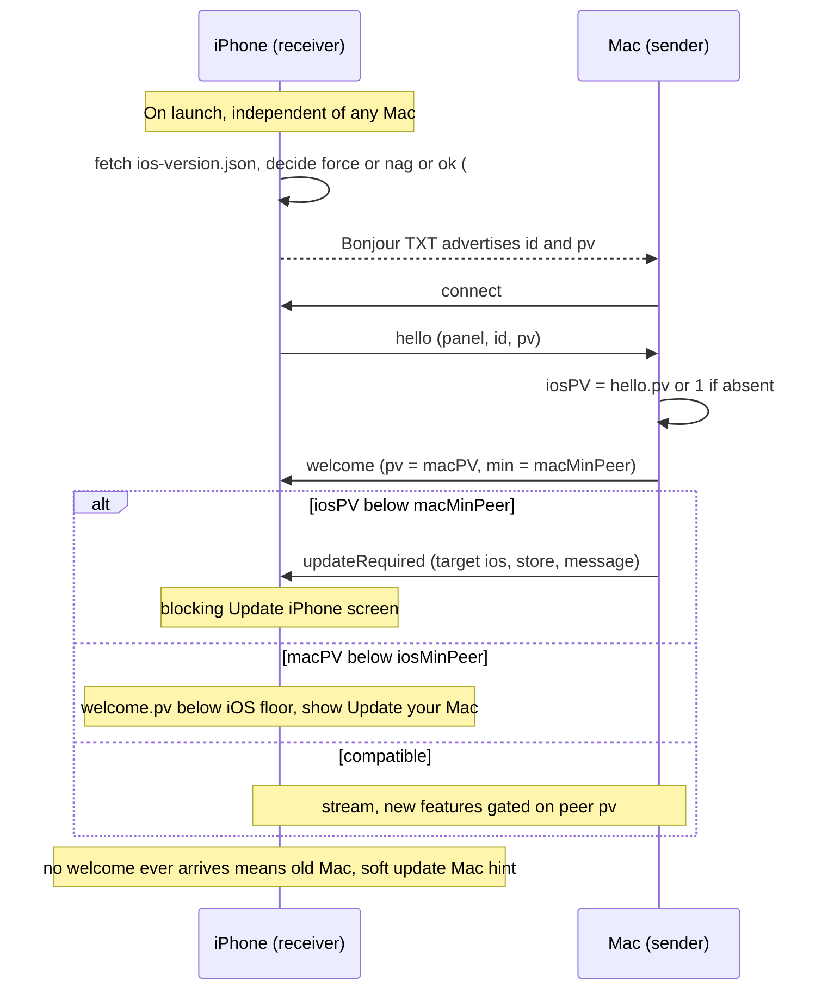

# Mac ↔ 接收端兼容性

Mac 发送端和接收端应用如何在**不同的更新节奏**下保持兼容，由谁检测不匹配，以及我们支持哪些配对。这一设计最初来自 OpenDisplay 的 iOS/Mac 兼容性工作（[上游 #132](https://github.com/peetzweg/opendisplay/issues/132) 发布编排、[上游 #135](https://github.com/peetzweg/opendisplay/issues/135) 强制更新，以及 wire 协议握手）。它是协议演进和规划参考，**不是商店发布状态报告**：当前版本和下载链接见 [README.md](../README.md#platform-availability--november-2-2026)。

MeowDisplay 在 iPhone、iPad、Android 和 Mac 上有接收端应用。主 Mac 应用既可发送也可接收；独立的仅接收端应用运行于 macOS 12 或更高版本。Android 2.0（封闭测试）需要 Mac 2.0 应用。所有接收端协商相同的共享 wire 协议，但具有不同的平台、发布渠道和能力限制。

新的窗口模式、台前预览、文件和剪贴板功能需要实现它们的对端。仅凭协议版本并不保证相同的 UI 或传输支持。当前接收端功能见 [PARITY.md](PARITY.md)，线上 wire 安全保证见 [PROTOCOL.md](PROTOCOL.md) / [SECURITY.md](../SECURITY.md)。下文针对 iOS 提出的远程配置和更新流程，并不一概意味着它在每个接收端上都会发布。

wire 协议本身——分帧、发现、视频格式以及完整的控制消息目录——在 [PROTOCOL.md](PROTOCOL.md) 中规定。本文档是*演进*它的配套政策。

> 状态：**草稿 / 部分实现。** 版本协商和 pv 11 安全传输边界已实现。标有*（计划中）*的章节描述目标行为。

---

## 1. 问题

MeowDisplay 协调 Mac 和移动端的发布，但分发并不同步：

| | 更新渠道 | 到达用户所需时间 |
|---|---|---|
| **Mac** | Sparkle appcast（`meowdisplay.app/appcast.xml`、`appcast-receiver.xml`） | 用户允许自动检查后一天内（Sparkle 会询问）；在用户接受后安装，除非用户选择了自动安装 |
| **iOS** | App Store（审核 + 用户点击 Update） | 数天 → 数周，并有**长尾** |
| **Android** | Google Play（测试/审核轨道和用户更新） | 审核、资格和推送可能与 iOS 不同 |

因此，任何时刻现场都存在许多版本配对。主要的是**新 Mac + 旧 iPhone**（Mac 通过 Sparkle 领先）。但反过来也会发生：大多数用户开启了 iOS 自动更新，因此手机可能跳到一个用户尚未安装对应 Mac 版本的构建——**新 iPhone + 旧 Mac**。

我们不能假定每个接收端都与 Mac 同步更新。这里删除了一个旧的上游版本采用率统计示例，因为它**不是经过验证的 MeowDisplay 使用数据**。

## 2. 两种不同的版本

请将它们分开——混为一谈正是陷阱所在：

- **应用版本**（`MARKETING_VERSION`，例如 `2.0.0`）——用户看到的版本，与 App Store / Sparkle 发布绑定。每次发布都会递增。
- **协议版本**（`pv`，一个整数）——应用之间的 wire 契约。**仅在 wire 变化时**递增，而不是每次发布都递增。仅涉及 UI 的发布不会改变 `pv`，因此永远不会触发兼容性事件。

**缺少 `pv` = 协议 `1`**，用于旧版兼容。这是针对旧对端的规则，**不是**声称当前 MeowDisplay 发布早于握手。较新的构建会声明其协商后的协议版本；请查阅 [PROTOCOL.md](PROTOCOL.md) 获取当前整数和能力。

每一方还会声明 **`minPeer`**——它仍支持的最旧对端 `pv`。两者均从 `1` 开始（支持一切）。我们只在有意进行的两阶段破坏性变更中（§6）才作为后半部分提高 `minPeer`。

### 安全传输边界

协议 11 要求 LAN/AWDL 媒体先经过配对和固定双向 TLS 1.3。配对、TLS 协商和 pin 失败绝不会回退到历史的明文 Bonjour 传输。当前 MeowDisplay 还要求 iOS USB 上使用已配对、固定的双向 TLS；没有明文 USB 例外。Bonjour 名称、地址、接口和 TXT 记录是发现提示，而不是身份。

Mac 系统音频（`pv` 12，PROTOCOL.md 第 5A 节）是同一连接上的媒体：它继承该连接已有的任何传输安全——LAN/AWDL 和 usbmux USB 隧道上的固定双向 TLS——没有单独通道、没有单独的 Bonjour 服务，也没有自己的认证会出错。在任何协议版本下，都刻意不存在未经认证或未加密音频的 wire 路径。

### 可选的 QUIC 传输（`pv` 22）

QUIC（PROTOCOL.md 第 2.4 节）纯粹是**增量式**的：

- `WireProtocol.version` 为 22；`minSupportedPeer` 保持为 **1**。不要求任何对端为 QUIC 更新。
- 只有当对端**已认证**的 `hello`/`welcome` 在 `transports` 中列出 `"quic"` 且 `qv` 为 1 时，它才支持 QUIC。缺少该字段——所有 pv ≤ 21 的构建——意味着仅 TCP，且绝不会从 `pv` 推断出 QUIC。`_meowdisp-q._udp` Bonjour 记录只是一个提示，可能为本地 QUIC 尝试提供依据；它绝不标记对端有能力或受信任。
- 新 Mac + 旧接收端 → TCP。旧 Mac + 新接收端 → TCP（接收端保留其 TCP 监听器，只是看不到 QUIC 拨号）。新 + 新 → Auto 可能使用 QUIC。对于远程访问，Auto 使用 TCP，直到一个已认证会话显示支持 QUIC，之后的会话可能使用 QUIC。
- 未知的 `qv` 会为该对端禁用 QUIC，而不是猜测。
- 已认证 `hello` 报告 `pv` 低于 22（降级为 QUIC 之前的构建）的对端会丢失任何记住的 QUIC 能力，并再次仅使用 TCP；决策使用该 hello 的 `pv`，绝不使用 Bonjour TXT 记录。
- 唯一一个与构建的*当前*版本进行比较的 pv 敏感检查（`streamingProfileRequest`）现在固定为 pv 21（`WireProtocol.streamingProfileRequestWireVersion`），因此这次版本提升不会停止对 pv 21 接收端的支持。
- 配对协议版本不变（13）；QUIC 复用相同的 pin。

## 3. 兼容性矩阵

令 `iosPV` / `macPV` 为两个协议版本，`macMinPeer` / `iosMinPeer` 为各方声明的最小支持对端。

| 条件 | 含义 | 结果 |
|---|---|---|
| `iosPV ≥ macMinPeer` **且** `macPV ≥ iosMinPeer` | 完全兼容 | **正常流式传输。** 新的可选功能以对端的 `pv` 为门槛，对旧对端保持关闭。 |
| `iosPV < macMinPeer` | iPhone 对此 Mac 而言太旧 | **更新 iPhone。** Mac 检测到（它看到 `iosPV`），驱动 UI。 |
| `macPV < iosMinPeer` | Mac 对此 iPhone 而言太旧 | **更新 Mac。** iPhone 检测到（它看到 `macPV`），驱动 UI。 |
| 以上两者 | 双方都低于各自的下限 | 双方都需要更新；每台设备显示修复*自身*的操作。 |

由于 `minPeer` 默认保持为 `1`，“太旧”行在**正常操作中为空**——只有在为破坏性变更有意提高下限后才会亮起。日常情况下，一切都是第一行：兼容，较新功能对旧对端关闭。

## 4. 谁检查什么——以及为什么不能只放在一侧

**直觉：**“把兼容性检查完全放在 Mac 应用中。”大体上正确，但有一个硬例外。Mac *确实*是天然的主要所有者：

- 它首先且持续更新，因此现场的 Mac 始终是最新的应用，可以携带最新、最聪明的兼容性表。
- 它已经在 `hello` 中接收 iPhone 的 `pv`，因此可以评估配对并**告诉 iPhone 显示什么**（`updateRequired`）。iPhone 保持简单。

**例外——需要更新的一方可能太旧而无法自知。** 如果一台 Mac 旧到与*更新的* iPhone 不兼容，它可能完全早于握手，无法诊断自己的过时。只有**新 iPhone** 能看到 Mac 落后。因此“更新你的 Mac”提示必须能够从 **iOS** 发起。

因此所有权是分裂的：

| 检测 | 所有者 | 机制 |
|---|---|---|
| iPhone 对此 Mac 太旧（常见情况） | **Mac**（主要） | 读取 `hello.pv`；发送 `updateRequired` → iPhone 渲染“Update iPhone”；还显示本地菜单栏提示 |
| Mac 对此 iPhone 太旧 | **iOS** | 读取 `welcome.pv`（或注意到根本没有 `welcome` 到达 → 旧 Mac）；渲染“Update your Mac” |
| 从未遇到有能力 Mac 的安装（例如旧版本长尾） | **iOS** | 远程配置强制杠杆（§5）——*唯一*能触及它的东西 |

**经验法则：** 每个应用都根据对端声明的 `pv` 执行自己的 `minPeer`；哪个应用足够新以*检测*到不匹配，就由它显示提示——如果需要对端设备更新，则针对对端设备显示。

因此：Mac 是主要所有者和策略的单一事实来源，但它**不能是唯一所有者。** iOS 保留对“旧 Mac”方向的最小检查，并拥有离线/从未连接的情况。

## 5. 远程配置强制杠杆（iOS）——issue #135

与连接无关。启动时，iPhone 获取我们托管在 Sparkle appcast 旁边的一个小型静态文件。

> **MeowDisplay 状态：已禁用。** `VersionGate.manifestURL` 为 `nil`，因此不会发起请求：MeowDisplay 尚未托管任何策略文件，且不得跟随 OpenDisplay 参考项目的策略文件。下文设计属于该项目，保留以备存在 MeowDisplay 自有的文件时使用。

- **URL：** OpenDisplay 使用 `https://opendisplay.app/ios-version.json`（事实来源：`public/ios-version.json`；Vite 将其复制到 `docs/`，Pages 提供它）。本仓库没有 `public/ios-version.json`。
- **结构：**
  ```json
  {
    "ios": {
      "hardMinimumVersion": "0.0.0",
      "recommendedVersion": "1.12.0",
      "storeURL": "https://github.com/raiseCatError/MeowDisplay",
      "message": "…"
    }
  }
  ```
- `storeURL` 是可选的。仅当它是 `https` 链接或 MeowDisplay 自己的 App Store 列表（`AppStore.iOSAppID`）时，应用才会打开它；其他任何内容，包括其他应用的列表，都会被替换为 `AppStore.receiverUpdateURL`——列表存在后用列表，在那之前用项目页面。Mac 的 `updateRequired.store` 也经过相同的检查。
- `version < hardMinimumVersion` → **阻塞性**更新屏幕（更新链接如上，不可关闭）。这就是强制。
- `hardMinimumVersion ≤ version < recommendedVersion` → **软性、可关闭**的提醒。
- **`hardMinimumVersion` 是强制下限：通过 PR 手动编辑，有意且罕见。** 它*不能*自动跟踪“latest”，否则每次发布都会强制更新（与我们的目标相反）。`recommendedVersion` 可以像 appcast 一样由 CI 自动标记。
- **失败时放行：** 任何网络/解析错误，或休眠的 `0.0.0` 下限，都不显示门禁——Pages 故障永远不会让应用变砖。开发构建（`0.0.0`）完全跳过检查。

为什么这是重要的杠杆：**你无法强制更新一个尚未包含强制检查的安装。** 当前的旧版本长尾根本没有检查——应用只能强制那些*随*它一起发布的构建。因此我们现在就发布检查（休眠下限）以启动饱和时钟，并且只有在具备强制能力的构建普及后才提高下限。

## 6. 我们支持什么——不支持什么

**支持：**

- **增量变更免费且默认。** 新的可选 `hello`/`welcome` 字段和新消息类型，以对端的 `pv` 为门槛。两个应用都已记录并忽略未知消息类型，并容忍缺失的可选字段，因此增量变更永远不会破坏旧对端。
- **示例：`pv` 4 键盘输入（M4）。** `keyboard` 消息族（PROTOCOL.md §6.1）与 `pv` 3 时的 `pencil`/`proximity` 一样是增量式的——旧 Mac 只是忽略未知的 `keyboard` 类型，因此不会有任何破坏。`pv` 提升的存在是为了让 iOS 能够门控*UI*：浮动键盘按钮仅在 `welcome.pv ≥ 4` 时出现，因为与触控笔输入不同，键入文本没有旧版回退——在旧 Mac 上显示该按钮会静默地键入到空处。双方的 `minPeer` 都保持为 `1`；`pv 3` 的 Mac 继续正常流式传输并接收触控/滚动/触控笔，只是没有键盘按钮。
- **示例：`pv` 5 指针/点击手势（M7）。** `pointer` 消息族（PROTOCOL.md §6.1）同样以增量方式工作——旧 Mac 忽略未知的 `pointer` 类型，因此不会有任何破坏。与键盘不同，这里*确实*有旧版回退：iOS 根据 `macSupportsPointerWire`（`welcome.pv ≥ 5`）进行门控，当它为 false 时，驱动 M7 之前的 `touch` 点击拖动行为，而不是直接隐藏功能。`minPeer` 保持为 `1`；`pv 4` 的 Mac 继续正常接收 `touch`/`scroll`，只是没有绝对指针/精确度/右键/右拖。
- **示例：`pv` 6 接收端控制。** 接收端在可选的 `hello` 字段中声明其本地托盘/键盘按钮状态。pv 6 的 Mac 可以用 `receiverUI` 更新这些字段，用 `inputReset` 重置接收端侧锁存状态，并接受显式的修饰键转换。旧对端忽略这些新字段/消息；iOS 根据 `welcome.pv >= 6` 门控修饰键/组合键传输，而现有原生键盘仍然可供 pv 4 和 pv 5 的 Mac 使用。
- **示例：`pv` 7 显示模式同步。** pv 7 接收端可以发送 `displayModeRequest`；Mac 通过其现有的模式切换路径应用它，并且仅在设置完成后回复权威的 `displayModeState`。旧对端忽略这些消息，除非 `welcome.pv >= 7`，接收端不会提供切换功能。
- **示例：`pv` 9 视频开/关。** pv 9 接收端可以独立于逻辑/输入会话请求视频生产。Mac 用 `videoState` 确认实际状态和保留的映射几何。对于旧接收端，Mac 保持视频开启，而旧 Mac 会让接收端的视频控制不可用，从而避免出现无解释的冻结画面。
- **示例：`pv` 10 连续应用手势。** pv 10 接收端可以发送重叠的缩放和旋转生命周期。wire 是增量式的，旧对端会忽略它。官方 Mac 目前会验证生命周期，但无法跨应用注入它：公开的 `CGEvent` 类型涵盖鼠标、键盘、滚动、数位板和相关事件，而 AppKit 接收到的 `NSEvent.magnification`/`rotation` 值是只读的，其公开事件构造函数不暴露手势负载/阶段。不使用任何私有事件字段或键盘快捷键模拟。
- **示例：`pv` 12 Mac 系统音频。** 音频帧使用保留的类型化标记字节（PROTOCOL.md 第 5A 节），而不是扩展第 4 节的启发式——这是启发式自身弃用说明所预见的“类型化帧头”的首次真正使用。它与 `keyboard` 一样属于无旧版回退的增量式：`pv < 12` 的对端从不发送 `audioRequest`，`pv < 12` 的发送端从不发出音频媒体帧，因此旧对端根本看不到任何新东西，甚至连它们会忽略的消息都没有。双方的 `minPeer` 都保持为 `1`；`pv 11` 的 Mac 继续正常流式传输视频并接受输入，只是接收端 UI 中的音频不可用。
- Mac 支持 **≥ N 个版本之前**的 iOS 接收端——*N 待定（见开放问题）；在决定之前，为“所有协议 1 接收端”。*
- iOS 支持可回溯到协议 1 的 Mac（尚未提高下限）。

**破坏性变更分两阶段（绝不要一次性）：**

1. **第 1 次发布**在*两个*应用上同时提供*新旧*行为的支持，新路径以 `pv` 为门槛。不会有任何破坏；仅当双方都足够新时，新路径才会激活。
2. **第 2 次发布**，仅在 iOS 构建经过 App Store 采用窗口后，提高相关的 `minPeer` 并删除旧路径。此时旧对端会得到干净的“请更新”提示，而不是静默中断。

**不支持 / 风险：**

- **静默破坏性变更。** 绝不在没有两阶段流程的情况下更改分帧或字段语义——故障模式是看不见的重连循环，而不是一条消息。
- **视频通道上 ≥ 32 KB 或包含 NUL 字节的控制帧。** 手机通过启发式区分 JSON 控制帧与 H.264 帧（`< 32 KB, starts with '{', no NUL`）。大型或二进制控制消息会被送入视频解码器。类型化帧头是未来的协议项目，仅因这次握手存在而解锁。
- **通过应用强制更新握手前的长尾。** 早于第一个具备强制能力的构建的安装没有杠杆——只能通过 Mac 的会话内 `updateRequired` 触及（如果它们连接到足够新的 Mac），否则它们就直接停止工作。对它们的优雅降级在*过渡期间*是强制性的，而不是长期承诺。

## 7. 消息流程*（计划中）*



## 8. 过渡计划

1. **现在：** 在*同一个* iOS 构建中发布——wire 上的 `pv`、`welcome` 处理、`updateRequired` 处理和远程配置检查。Mac 发布 `pv` + `welcome` + `updateRequired` 发送端。**所有下限保持为 `1` / `hardMinimumVersion` 保持 `0.0.0`（休眠）。** 暂时不强制任何人；目标只是把机制部署到现场。
2. **饱和：** 观察各版本采用情况。在具备能力的构建普及之前，这些杠杆不起作用。
3. **在合理时切换：** 提高 `ios-version.json` 的 `hardMinimumVersion` 以淘汰古老的 iOS 基础，和/或针对特定破坏性变更运行两阶段 `minPeer` 提升。每个过渡/优雅兼容层都附带一个移除工单。

## 9. 开放问题（需要决策）

- **`N`** —— 在允许我们删除某条路径之前，Mac 必须支持多少个 iOS 版本？（“All v1”是占位符。）
- **不兼容配对：拒绝还是降级？** 建议：保持链接并在过渡期间降级；只有在有意提高下限之后才拒绝连接。
- **iOS 上“Update your Mac”的严重程度** —— 阻塞还是软性？建议：除非 `macPV < iosMinPeer`（真正的硬下限），否则为软性提示，然后阻塞。
