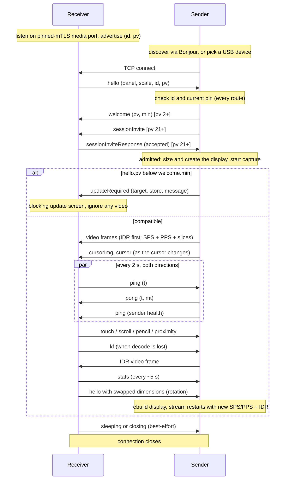

# OpenDisplay 线协议

**协议版本（`pv`）：21** &nbsp;|&nbsp; 状态：对 `pv <= 21` **规范性**

本文档规定 OpenDisplay *发送端*（桌面被扩展的机器，目前是 Mac 应用）与
OpenDisplay *接收端*（显示附加显示器的设备，目前是 iPhone/iPad 应用）之间
使用的线协议。它描述跨套接字传输的一切，不描述任一端内部发生的事情：
显示器创建、采集、编码、解码、渲染和输入注入都是各端的实现细节，不在
本文档范围内（非规范性提示见[附录 B](#appendix-b-implementers-notes-non-normative)）。

两份配套文档：

* [COMPATIBILITY.md](COMPATIBILITY.md) 是*演进*本协议的政策：版本协商的
  理由、默认增量的规则，以及破坏性变更的两阶段流程。本文档描述线协议的
  现状；那份文档描述它如何变化。
* [README.md](../README.md) 给出产品层面的概览。

### 命名

本协议以产品命名为 **OpenDisplay 协议**。由于历史原因，Bonjour 服务类型是
`_opensidecar._tcp`（项目最初的名称），并将保持如此：重命名它会让所有已部署
的对端失效，却没有任何功能收益。不要对这种不一致做任何过度解读。

### 不承诺支持

本规范的存在是为了让独立实现能够与官方应用以及彼此之间互操作。发布本规范
**并不**承诺为其他平台提供官方应用、保持协议冻结，或支持第三方实现。
第三方客户端导致的问题应报告给相应项目。

### 约定

关键词 MUST、MUST NOT、SHOULD、SHOULD NOT 和 MAY 按
[RFC 2119](https://www.rfc-editor.org/rfc/rfc2119) 所述解释。
除非明确指明其他版本，否则每项要求都适用于 `pv` 12。“官方应用”指本仓库中的
Mac 发送端和 iOS 接收端；它们的行为仅作为示例引用，除非标记为规范性内容，
否则不构成要求。

---

## 1. 角色与传输 (Roles and transport)

* **接收端监听**固定的双向 TLS 1.3 媒体端口（`WireCrypto.tlsPort`）并对外
  通告自身。**生产环境的媒体、控制和输入会话绝不通过明文运行**：LAN、Remote
  和 USB 都汇聚到这一个固定 mTLS 监听器上。原先的明文 TCP 9000 媒体监听器
  （以及依附于它的 UDP 光标监听器）已被移除；仅支持明文的旧发送端会直接连接
  失败（没有降级路径）。配对（端口 9002）是独立的引导协议。
* **发送端连接**接收端。

这一角色分配是协议中最关键的决策，MUST 得到保留：因为接收端始终是监听方，
所以发送端通过 WiFi（拨打发现到的地址）和通过 USB（拨打隧道端口）到达它的
方式完全相同，一份代码路径即可服务两种传输。

* 协议运行在**单一的固定双向 TLS 1.3 连接**上。视频、控制消息、光标和遥测
  都在这条连接上双向共享。（历史上的 UDP 光标旁路通道，见 6.3 节，已被
  移除。）
* 下文描述的成帧是*内层*应用流；历史上 `pv` 3 关于“无 TLS、无认证”的描述
  不再适用于生产环境。实现 SHOULD 禁用 Nagle 算法（TCP_NODELAY）；输入事件
  是很小的数据包，合并它们会表现为输入延迟。
* 一个接收端**一次只服务一个发送端**。当已有活动连接时又有新的入站连接
  到达，接收端 MUST 采用新连接并丢弃旧连接（官方接收端会取消旧连接并重置
  其解码器状态），但有一个例外：**为另一台 Mac 做先建后断。** 当当前会话
  已获接纳（6.9）时，若某连接证书解析到*不同的*已固定对端，它到达时不会
  替换当前会话。接收端向它发送 `hello`，只读取其 `welcome`、`sessionInvite`
  和 `sessionInviteCancel`，用 `ping` 保持其存活，并照常回应其邀请（在询问
  用户期间为 `pending`）。只有当该邀请被接受时，新连接才替换会话；若被拒绝、
  阻止、撤回、静默或未获答复，则关闭该连接，当前会话不受影响。如果当前会话
  先结束（并非因本设备主动断开），则等待中的连接按新连接评判。pv 21 之前的
  发送端无法被询问，只有当其自动邀请会被接受时，才会替换会话。来自同一对端
  的重连永远不会被挂起。发送端无需改动：它们已经会等待 `accepted` 后才开始
  推流。

## 2. 传输绑定 (Transport bindings)

核心协议除“通往接收端媒体端口的固定双向 TLS 字节流”之外与传输无关。发送端
如何找到该端口是一种*绑定*。目前存在两种绑定；面向其他平台的移植 MAY 定义
自己的绑定（例如通过 `adb forward` 访问 Android 接收端），而无需改动本文档中
的其他任何内容。

### 2.1 WiFi / LAN (Bonjour)

接收端通告一个 Bonjour（mDNS/DNS-SD）服务：

* **类型：** `_opensidecar._tcp`
* **名称：** 人类可读、用户可编辑的设备名称（默认为设备名称）。名称仅用于
  显示。它 MUST NOT 被用作设备身份：用户会重命名设备，而且两台设备可以共用
  一个名称。
* **TXT 记录键：**

| 键 | 值 | 起始版本 | 含义 |
|---|---|---|---|
| `id` | UUID 字符串 | pv 1 时代 | 每次安装的稳定身份。MUST 等于稍后在 `hello` 中发送的 `id`。让发送端能够识别“同一设备，不同传输/名称”。 |
| `pv` | 以字符串表示的十进制整数，例如 `"3"` | pv 2 | 接收端的协议版本。缺失表示 `pv` 1。让发送端在拨打前评估兼容性。 |

一次显式 Connect 期间（6.9 节），该记录还会临时携带一次性 `cr` 令牌和
被点名的发送端 `crt` install id；两者都是仅用于发现的未认证元数据。

发送端 MUST 容忍缺失的 TXT 记录和缺失的键（`pv` 2 之前的接收端两者都不
通告）。

在 pv 11，此服务解析到 TCP 端口 9001，并承载 TLS 1.3。双方都出示持久的
自签名 P-256 证书，并依据各自存储的对端 pin 验证叶证书的 SubjectPublicKeyInfo。
握手失败、pin 缺失或密钥变化都是终止性的，MUST NOT 以明文重试。

未配对的 pv 11 接收端还会在 TCP 端口 9002 上通告 `_opendisplay-pair._tcp`。
它只用于发现，不构成信任，也不携带任何秘密。Mac 发送端在运行期间通告
`_opendisplay-mac-pair._tcp`，以便接收端呈现产品主要的“附近的 Mac → 配对”
流程。两种配对通告都携带 `id` 和 `pv` 发现元数据（以及 `pp` 配对版本提示），
绝不携带秘密。可选的 `os` TXT 键为 `macos` 或 `linux`，仅用于选择接收端的
主机类别 UI；缺失或无法识别的值出于兼容性仍视为 `macos`。它不是安全或能力
决策。

当多个人登录到同一台 Mac 时，每个人的发送端可以选择在
`_opendisplay-mac-pair._tcp` 上增加四个 TXT 键，以便接收端将一台 Mac 及其
登录会话一起列出（增量式，无需更改 `pv`；见
[SAME_MAC_SESSIONS.md](SAME_MAC_SESSIONS.md)）：`hg`（16 个小写十六进制
数字，同一台 Mac 的每个会话都相同）、`hn`（Mac 的名称）、`sl`（该会话选择的
标签，最多 32 个字符）和 `ss`（当该登录会话位于控制台时为 `a`，被切换出去时
为 `i`）。与 TXT 中的所有内容一样，它们未经认证：接收端仅用于排列和标记
行，MUST NOT 让它们影响配对、pin、接纳或输入，并且当其中任何一个格式错误或
`id` 缺失时，MUST 忽略全部四个键。

### 2.2 USB（Apple 设备）

对于有线连接的 iPhone/iPad，发送端通过 **usbmuxd** 拨号，这是 macOS 自带的
设备多路复用守护进程，也可在 Linux 和 Windows 上通过
[libimobiledevice](https://libimobiledevice.org) 使用。发送端要求 usbmuxd
在所选设备上 `Connect` 到接收端的 mTLS 媒体端口（通过一个仅拼接密文的
一次性回环桥接）；在收到 `OK` 结果后，usbmuxd 套接字成为透明的字节管道，
协议随后完全像 WiFi 上一样继续。

Bonjour 在此路径上不起任何作用。官方接收端将来自回环的连接归类为“USB”，
纯粹是为了统计显示；这没有协议意义。

USB 只是一种路由：相同的固定双向 TLS 在 usbmux 管道内运行，不存在明文 USB
路径。Mac 也可以通过线缆发起配对——当带有 pin 的设备接入时，通过同一隧道
拨打端口 9002。这就是 2.3 节的普通配对仪式，包括双方屏幕上的 SAS 比对；
线缆绝不会被当作任何事物的证明。不存在单独的 USB 信任记录。USB `hello`
与任何其他路由遵循完全相同的身份规则（6.9 节，“接纳按连接进行”）：其 `id`
必须是发送端拨打的同一对端，其证书必须出示该对端当前的 pin。

### 2.2a Android 接收端

官方 Android 接收端原样使用绑定 2.1：相同的 Bonjour 服务类型和 TXT 键
（通过平台的 DNS-SD 发布），相同的固定双向 TLS 1.3 媒体监听器（TCP 9001）
和配对监听器（TCP 9002），以及相同的 `_opendisplay-mac-pair._tcp` 浏览，
用于其“附近的 Mac → 配对”流程。其持久身份是 Android Keystore 中的 P-256
密钥；其 pin 是该密钥的 SubjectPublicKeyInfo DER，像其他所有 pin 一样逐字节
比较。它发送 `hello.device` `"Android"`。ExtendPad 的 Android USB 绑定使用
经过授权的 ADB 主机到设备 `adb forward` 隧道，通往相同的媒体和配对端口；
2.2 节仍是 usbmuxd，而它只能到达 Apple 设备。Android 在拥有 QUIC 监听器之前
不会在 `transports` 中列出 `"quic"`，因此发送端通过 TCP 到达它。USB 隧道不会
改变传输绑定之上的任何内容。

USB 发现与媒体分离。当恰好连接了一台已授权的 Android 设备时，Mac 在 TCP
9005 上发布一个设备到主机的 `adb reverse` 隧道，通往发现监听器。接收端发送
一个带长度前缀的 JSON 请求（4 字节大端正文字节长度，最多 16 KiB）：
`discover`，或者在用户明确选择后，发送带有选定 Mac 的 `peerID` 的
`connect` / `pair`。版本 1 的响应仅包含主机的 `peerID`、显示 `name`、本接收端
是否 `paired`，以及 `platform`（`macos` 或 `linux`；缺失表示 `macos`）。
`connect` 或 `pair` 请求 MAY 还携带接收端自己的 `receiverID`（其安装 id）。
Mac 仅用它把已固定的对端与此 USB 设备匹配——例如通过 Wi-Fi 配对过的接收端，
不存在 USB 设备映射；固定 TLS 握手仍然证明身份，因此该字段不授予任何信任。
省略该字段的接收端必须首先通过 USB 配对。发现不授予信任，也不启动采集。
连接和配对仍然使用现有的固定双向 TLS 媒体和配对监听器。USB 和 Wi-Fi 都不会
被自动选择或迁移。

Android 还可以通过 TCP 访问不在本地网络上的已配对 Mac（Remote Access），
使用每个接收端都用的两种绑定，线协议上没有任何新内容。**敲门（Knock）：**
接收端在已保存的地址上，向 Mac 的 `remoteRequestPort`（TCP 9003）打开一个
固定双向 TLS 1.3 连接，发送 6.9 节中的那个 `remoteConnectRequest` 帧（仅当
其用户自己的 Connect 尚未完成时为 `manual`，在丢失远程会话后进行的受限恢复
为 `automatic`），然后关闭。Mac 作出决定，然后完全像处理本地请求一样拨打
接收端的 TCP 9001 监听器（先 Bonjour，再其保存的提示，最后是敲门包的源
地址）。接收端固定 Mac 的密钥，绝不固定地址，并将该地址上出现不同密钥视为
安全失败，而不是重试。**通过 Remote 配对：** 接收端拨打 Mac 的远程配对
监听器（TCP 9004，在 Mac 用户启动“通过 Remote 配对”后开放 180 秒），并以
发起方身份运行与 2.3 节相同的配对仪式：commit/reveal、双方屏幕上的六位
代码、双方确认。两种绑定都不授予输入，地址是按已验证对端 ID 保存的提示。
Android 使用与 Mac 相同的规则验证输入的地址
（`fixtures/remote/endpoint-vectors.json`，两套测试都会重放它），并逐字节
按照 `fixtures/remote/knock-frame-vectors.json` 构造敲门帧（双方都会测试）。

### 2.3 首次配对（配对版本 13）

配对监听器（端口 9002）可被网络上的任何人访问，因此在显示任何代码之前，
发起方先对其 hello 作出承诺：

1. 发起方发送 `helloCommit`：其 hello 规范编码在域
   `MeowDisplay-Pairing-HelloCommit-v13` 下的 SHA-256（角色、版本、设备 ID、
   名称、身份 SPKI、临时密钥、nonce，每项均带长度前缀），32 字节。它必须在
   连接建立后 10 秒内到达；响应方只保留少量尚未发送该消息的连接（Apple 和
   Android 上为 4 个），其余立即关闭。
2. 响应方一次最多接纳一个承诺；连续三次失败尝试（reveal 缺失或不匹配，或
   一个已显示的代码随后被拒绝、超时或中止）会使其监听器冷却 30 秒。只有
   在这之后，它才发送自己的 hello。
3. 发起方在 5 秒内发送 `helloReveal`，即其 hello。响应方对照承诺进行检查；
   不匹配则结束本次尝试。

由于发起方在看到响应方的 hello 之前就已绑定自己的 hello，它无法搜索能产生
选定 SAS 的 hello。交换随后按下文继续。双方必须严格使用此版本；不存在降级。

每一方生成一个新的 P-256 ECDH 密钥和 32 字节 nonce。配对 hello 消息包含
协议版本、稳定设备 ID、显示名称、持久 TLS 身份 SPKI、临时公钥和 nonce。
规范转录按角色排序，并为每个字段加长度前缀。

双方计算 P-256 ECDH 和 HKDF-SHA256，以转录哈希为 salt，并使用协议特定的
域。一个单独进行域分离的值被缩减为六位 SAS，显示为 `123 456`。SAS 用于
认证本次交换；它绝不是密码或加密密钥。在用户在双方设备上确认匹配后，每一方
在角色特定的 HKDF 密钥下发送 HMAC-SHA256 确认。只有在本地接受且收到有效的
被接受对端确认之后，才会保存对端 pin。

更改任何身份、临时密钥、nonce、角色、名称、ID 或版本都会改变转录和 SAS。
具有不同 SPKI 的现有对端 ID 绝不会被覆盖；恢复需要“忘记设备”。消息使用
普通的 big-endian 长度成帧，限制为 64 KiB，并且在媒体监听器上无效。

### 2.4 QUIC（`pv` 22，可选）

QUIC 是网络路由（LAN、AWDL、Remote）上的**增量式第二安全传输**。TCP
（2.1–2.3 节）仍完全受支持，且始终是不具备 QUIC 能力的对端所使用的传输；
USB 从不使用 QUIC。路由（USB / LAN / AWDL / Remote）与协议（TCP / QUIC）
相互正交：发送端首先像以前一样选择路由，然后在该路由内选择 TCP 或 QUIC。

**发现与端口。** QUIC 监听器已绑定的接收端还会通告 `_meowdisp-q._udp`，
其实例名称与其 `_opensidecar._tcp` 服务**相同**，端口为 **UDP 9001**
（`QUICTransport.udpPort`；TCP 和 UDP 端口空间相互独立，因此 TCP 9001 保持
不变）。其 TXT 记录仅携带 `id`、`pv` 和 `qv`（QUIC 应用成帧版本，当前为
`1`）。它是可达性/能力**提示**：绝不建立信任，绝不作为能力持久化，也绝不
携带一次性 `cr` 连接请求令牌（该令牌留在 `_opensidecar._tcp` 上，因此一次
用户操作只会被处理一次）。Remote Access 端点提示通过 UDP 到达相同主机和
端口号上的 QUIC。

**安全性。** QUIC 集成的 TLS 1.3 配置与 TCP 规则完全相同：双方使用相同的
持久自签名身份，监听器要求客户端证书，并且针对已存储的 pin 进行相同的
叶证书 SPKI 验证（`TLSConfigurator`）。不存在 QUIC 专用的密钥、pin 或信任
存储，也不存在明文形式。ALPN 固定为 `meowdisplay-quic/1`；不具备它的对端
会握手失败。会话票据和恢复被禁用，因此**不可能存在 0-RTT 早期数据**：
在完整认证握手之上、经过未改变的 `hello` 身份检查和会话接纳（6.9 节）之前，
绝不会对任何 MeowDisplay 消息采取行动。

**流。** 每个会话的一条 QUIC 连接恰好承载三条长寿命、可靠、**由发送端
打开的双向**流：

| 通道 | 字节 | 载荷方向 | 承载内容 |
|---|---|---|---|
| Control | `0x01` | 双向 | 所有 JSON 控制消息（hello/welcome、邀请、ping/pong、输入、设置、`kf`、光标、拆除） |
| Video | `0x02` | 发送端 → 接收端 | Annex-B 访问单元（5 节，不变）加上 `videoState` / `streamCodecState`，它们随 Video 传输，以便与其描述的帧保持顺序 |
| Audio | `0x03` | 发送端 → 接收端 | 带 `0x01` 标记的音频媒体帧（5A 节，不变） |

每条流都以 8 字节前导开始；其通道**仅**来自前导，绝不来自 QUIC 流 ID 或
打开顺序：

```
0..3  "MEOW" (4D 45 4F 57)
4     QUIC application framing version (1)
5     channel (0x01 / 0x02 / 0x03)
6..7  flags, big-endian, 0 in v1
```

在前导之后，每条流使用 3 节的成帧
（`[UInt32 BE length][payload]`）。接收端不会在 Control 流的反向方向上写入
前导。接收端 MUST 拒绝（关闭 QUIC 连接）：错误的 magic、版本或非零 flags；
未知通道；同一通道的第二条流；超过三条流；任何单向流（接收端通告的双向流
上限为四，因为 Apple 的 Network.framework 自己使用 QUIC 流 0，而发送端的流
从流 4 开始；只有实际打开的流才计入三条）；与其通道不匹配的载荷类型；声明
长度为 0 或超过通道上限（Control 和 Audio 为 1 MiB，Video 为 32 MiB——即
4096×4096 帧的原始 4:2:0 大小加余量，大于接收端 4096 像素解码上限下任何
合法访问单元），并在缓冲之前检查；在帧中途结束的流；以及会话被接纳之前的
任何 Video 访问单元或 Audio 帧。发送端 MUST 以同样方式对待接收端打开的流，
或接收端在 Video/Audio 上写入的任何字节。接收端拒绝超过小型活动上限的
QUIC 连接，关闭前导在 5 秒内未到达或 Control 流在 10 秒内未到达的连接，
并在会话放弃其 Control 流时关闭 QUIC 连接。

应用错误码（诊断用；v1 将其记录在本地日志中并取消连接，不放到线路上）：
`0x100` invalidStreamPreface，`0x101` unsupportedTransportVersion，`0x102`
duplicateChannel，`0x103` unexpectedChannel，`0x104` sessionNotAdmitted，
`0x105` protocolViolation，`0x106` peerRevoked。

**能力。** 双方在 `hello`（接收端）和 `welcome`（发送端）中添加
`transports`（例如 `["tcp","quic"]`）和 `qv`——位于已认证会话内部。接收端
仅在其 QUIC 监听器已绑定时列出 `quic`。能力缺失表示仅 TCP；绝不从 `pv`
推断 QUIC。Mac 只记住每个对端的**正向**已认证能力；不兼容的 `qv` 会为该
对端禁用 QUIC；`pv` 低于 22 的已认证 `hello`（该对端现在运行 QUIC 之前的
构建）会清除该能力，而列出仅 TCP 的 pv 22+ 对端（监听器暂时未绑定）会保留
该能力；忘记会移除它。

**选择（发送端，按设备：Auto / QUIC / TCP，默认 Auto）。**

* *TCP*：始终使用 TCP。
* *QUIC*：当已知该对端支持时使用 QUIC；否则会话报告 QUIC 不可用——它绝不
  静默使用 TCP。
* *Auto*：当 QUIC 不受支持（没有已认证能力；在本地路由上，兼容的 Bonjour
  提示可以证明一次尝试合理，而在 Remote 上只有已认证能力才行）或 QUIC
  冷却处于活动状态时使用 TCP；否则使用 QUIC。无论哪种协议先完成已认证的
  `hello`，都会在逻辑会话的剩余时间内保持——没有周期性重新挑战，也没有
  指标驱动的切换。
* 平台仅报告为*等待中*的拨号（Network.framework 的 `.waiting`，例如路径
  恢复时的 `ENETDOWN`）不是失败：它会继续等待就绪，并受相同的 8 秒应用
  握手超时限制。只有平台的*失败*状态才结束拨号。
* 只有普通的**可达性**失败（拨号后 8 秒内无应答、ICMP 拒绝、网络/主机
  不可达、DNS）才允许 Auto 回退到安全 TCP；随后它会为该对端和路由类型启动
  10 分钟的内存冷却，并在逻辑会话的剩余时间内保持 TCP。**安全性**失败
  （任何 TLS 失败：pin 不匹配、证书、缺少客户端证书、ALPN）或已认证的
  **协议违规**会以信任/协议错误结束尝试，且绝不回退。模糊错误会重试 QUIC，
  而不是切换。
* 丢失的活动 QUIC 会话会恰好获得一次 QUIC 恢复拨号；如果该拨号随后因
  可达性失败，Auto 按上述方式回退。
* 在活动会话上更改设置：显式 TCP/QUIC 仅在协议不同时通过普通传输交换
  （9 节）进行迁移；Auto 保持当前协议，直到下一次重连或路由变化。

**迁移。** TCP 和 QUIC 连接绝不会互相变异。协议更改与路由更改一样，是同一次
热传输交换：保持的输入被取消，旧连接的权限失效，新连接经过认证、发送
`hello` 并再次被接纳；没有任何输入授权延续；视频用关键帧重新同步，音频
开始新的一代。不存在先建后断。

## 3. 成帧 (Framing)

**双向**的每条消息都带有长度前缀：

```
[4-byte payload length, unsigned, big-endian][payload]
```

* 长度只计算载荷，不包含 4 个头部字节。
* 帧要么是**视频帧**（5 节），要么是**控制消息**（6 节），按 4 节所述区分。
* **接收端到发送端**，载荷 MUST 为 `1` 到 `2^20 - 1` 字节。官方发送端将长度
  为 0 或 `>= 2^20` 视为协议错误，并停止读取该连接上的控制消息。
* **发送端到接收端**，载荷 MUST 小于 `32 MiB`（`2^25` 字节）。当帧声明超过
  该值时，官方接收端会在缓冲任何内容之前结束连接。控制消息还进一步受下文
  解复用规则的约束，视频帧 SHOULD 保持在低兆字节范围（大面板的关键帧）。
* TCP 不提供消息边界：任一角色的接收端 MUST 缓冲并重组；一个帧 MAY 跨多次
  套接字读取到达，或与其他帧一起打包在一次读取中。

## 4. 通道解复用（已弃用的启发式） (Channel demux)

所有接收端到发送端的帧都是 JSON 控制消息，因此发送端不需要解复用。

发送端到接收端的帧在同一条连接上同时承载 H.264 视频和 JSON 控制消息。
在 `pv <= 3` 时，接收端**启发式地**区分它们。当且仅当以下三条全部成立时，
帧才是 JSON 控制消息：

1. 载荷长度 `< 32768` 字节，且
2. 首字节是 `{`（0x7B），且
3. 载荷不包含 NUL 字节（0x00）。

其他任何内容都是视频帧。这之所以可行，是因为 Annex B 起始码
（`00 00 00 01`）保证每个视频帧中都含有 NUL 字节，包括以 `{` *开头*的视频帧
（遥测前缀，5.1 节）。

对发送端**具有规范性**的后果：

* 发送端 MUST NOT 发出长度为 32768 字节或更长、不是以 `{` 开头，或包含 NUL
  字节的控制消息。最大的官方控制消息——base64 光标精灵（`cursorImg`）——
  将其 PNG 精确限制在 24000 字节，以便在 base64 扩展后仍低于此限制。更长
  的消息应分片发送给能够重组的接收端（6.14 节），绝不能作为单个帧发送。
* 发送端 MUST NOT 发出满足 JSON 测试的视频帧（对于格式良好的 Annex B 载荷，
  这不可能发生）。

**弃用。** 此启发式是设计债务，不是特性。在此规定它是为了让 `pv <= 4` 的
实现达成一致，并且**预计将在未来的 `pv` 中被类型化帧头取代**（在长度前缀
和载荷之间加入判别符）。该变更将遵循 COMPATIBILITY.md 第 6 节的两阶段流程：
先发布同时理解两种成帧的版本，然后在采用率饱和后，发布要求新成帧的版本。
实现 SHOULD 将解复用决策隔离在代码中，以便低成本替换，并且 MUST NOT 构建
依赖该启发式边缘情况的特性（例如故意发送二进制控制数据以将其路由到视频
路径）。

## 5. 视频 (Video)

视频流是 **H.264 Annex B**，每个线帧一个*访问单元*（一幅编码图像）。通告
支持 HEVC 的接收端 MAY 改为接收 **HEVC (H.265) Main 8-bit**，成帧方式相同
（5.4 节）。

### 5.1 帧布局 (Frame layout)

```
[optional telemetry prefix: JSON, no start codes]
[00 00 00 01][NALU] [00 00 00 01][NALU] ...
```

* **遥测前缀。** 第一个起始码之前的所有内容（如果有）是发送端打上的 JSON
  对象：`{"cap":<ms>,"snd":<ms>}`，其中 `cap` 是采集时间戳，`snd` 是发送
  时间戳，二者均为发送端时钟下自 Unix 纪元起的毫秒数。接收端 MUST 容忍其
  缺失，并 MUST 忽略未知字段；它仅用于延迟测量（结合 8.1 节的时钟偏移）。
  发送端 SHOULD 包含它。
* **起始码始终为 4 字节**（`00 00 00 01`）。发送端 MUST NOT 发出 3 字节
  起始码；因此接收端 MAY 仅按 4 字节模式分割。（同时处理 3 字节码的接收端
  目前只是碰巧可用；两个方向都不要依赖这一点。）
* **关键帧携带其参数集。** 每个 IDR 帧 MUST 以当前的 SPS 和 PPS NALU 为
  前缀。非关键帧仅携带切片数据（加上可选的 SEI，接收端 MAY 跳过）。
* 一幅图像的所有切片 MUST 在一个线帧中传输；接收端 SHOULD 将每个线帧作为一个
  样本解码。
* **没有表示时间戳**跨线传输。该流是低延迟的（官方发送端中没有 B 帧）；
  接收端按到达顺序、以到达速度显示帧。

### 5.2 流变化 (Stream changes)

编码视频尺寸由发送端选择，MAY 不同于 `hello` 中通告的面板尺寸（官方发送端
提供缩小比例的质量预设）。接收端 MUST 从 SPS 获取视频尺寸，绝不能从
`hello` 获取。

当流改变尺寸（设备旋转、质量变化）时，发送端只是开始发送带有新 SPS/PPS 的
帧。接收端 MUST 检测参数集变化，重建其解码器，并丢弃旧格式的缓冲帧。

### 5.3 关键帧恢复 (Keyframe recovery)

无法解码的接收端（在 GOP 中途加入、丢失解码器，或从后台恢复）通过 `kf`
控制消息（6.1 节）请求关键帧。发送端 MUST 通过使下一个发送的帧成为 IDR
（带 SPS/PPS，按 5.1）来响应。发送端 SHOULD 在连接（重新）建立时也主动
发送 IDR，包括在屏幕静止且采集器不产生任何内容时重放最后采集的帧。

### 5.4 HEVC (`hello.codecs`, `streamCodecState`, `pv` 19)

HEVC 是可选的、增量式的；H.264 仍是通用基线。

* **能力。** 接收端在 `hello.codecs` 中列出它能够硬件解码的编解码器（字符串
  数组）：始终包含 `"h264"`，仅当存在硬件 HEVC 解码器时才加上 `"hevc"`。
  该字段本身就是能力信号：省略它的接收端无论 `pv` 是多少都仅支持 H.264，
  发送端 MUST NOT 向其发送 HEVC。
* **选择。** 仅由发送端根据其用户偏好（Auto、H.264 或 HEVC）以及双方的硬件
  支持来选择编解码器。除非 H.264 将不得不降低请求的流且双方都支持 HEVC，
  否则 Auto 使用 H.264。解码上限（6.5 节）适用于两种编解码器。
* **通告。** `{"type":"streamCodecState","codec":"h264"|"hevc","reason":<string>}`
  （发送端 -> 接收端）指明后续帧的编解码器。它在编码器每次（重新）构建时
  发送，并在每次 `hello` 之后再次发送，仅发送给发送过 `codecs` 的接收端。
  它通过承载视频帧的通道传输（在 QUIC 上为 Video 流——2.4 节），以便与视频
  帧保持顺序。`reason` 是诊断文本；接收端 MUST NOT 据此分支，并且 MUST
  忽略它不认识的 `codec`。
* **成帧。** HEVC 访问单元遵循 5.1，使用 HEVC NAL 头：NAL 类型为
  `(byte0 >> 1) & 0x3F`，每个 IDR 都以当前的 VPS、SPS 和 PPS 为前缀。在
  编解码器变更时，接收端丢弃其参数集和解码器状态，并等待新编解码器的
  关键帧。
* **回退。** 发送端可以随时将 HEVC 流切回 H.264——当 HEVC 编码器无法创建或
  不产生帧时，或当稍后的 `hello` 不再列出 `"hevc"` 时——并在第一个 H.264
  帧之前通过 `streamCodecState` 通告。

## 5A. Mac 系统音频（`pv` 12）

发送端系统音频的副本——绝不是其物理输出的重路由，也绝不是第三方虚拟音频
设备——以 AAC-LC 与视频流一起传输。没有遗留回退（像 `keyboard` 那样，而
不像 `pencil`/`pointer`）：当对端的 `pv` 低于 12 时，接收端 MUST NOT 发送
`audioRequest`，发送端 MUST NOT 发出音频媒体帧。音频通过
`audioRequest`/`audioState`（6 节）按接收端选择加入；绝不会未经请求就发送。

### 5A.1 成帧：带类型的标记字节 (Framing: the typed marker byte)

4 节的通道解复用是有文档记录的启发式，而不是可供扩展的基础：它之所以
可行，只是因为 Annex B 起始码保证存在 NUL 字节，且控制消息是 JSON。音频帧
则改为以一个**保留的单字节标记** `0x01` 开头，而 JSON 控制形状（以 `{`
开头，0x7B）和遗留视频形状（同样以 `{` 开头，即遥测前缀）都无法产生它：

```
[0x01][subtype: 1 byte][subtype-specific body]
```

接收端在运行 4 节解复用**之前**先检查此字节。由于音频帧以 `pv` 12 为门槛，
低于该版本的对端永远不会收到它，因此引入此判别符无需两阶段迁移——它只会
出现在双方已同意能够承载它的线路上。发送端 MUST NOT 向 `pv` 低于 12 的
对端发出音频媒体帧。

存在两种子类型：

**`0x01`——配置。** 在音频开始时发送一次（如果格式变化则再次发送），以便
接收端在任何数据包到达之前构建解码器：

```
[sampleRate: uint32 BE][channelCount: uint8][cookieLength: uint16 BE][cookie: cookieLength bytes]
```

`cookie` 是 AAC AudioSpecificConfig（MPEG-4 “magic cookie”），接收端需要
用它来构造 `CMAudioFormatDescription`（或等效物）。

**`0x02`——数据包。** 一个编码后的 AAC-LC 访问单元：

```
[sequence: uint32 BE][capturedAtMs: int64 BE][durationMs: uint32 BE][payloadLength: uint32 BE][payload: payloadLength bytes]
```

* `sequence` 从 1 开始，在此采集代次中每发送一个数据包递增 1；仅供参考
  （数据包丢失/重排检测），由于 TCP 不会丢失或重排字节，播放并不需要它。
* `capturedAtMs` 是**发送端时钟下**自 Unix 纪元起的毫秒数，取自音频样本
  自身的采集表示时间戳——与视频遥测前缀的 `cap` 字段（5.1 节）处于同一
  坐标空间，因此接收端复用相同的 ping/pong 时钟偏移（8.1 节），以相对于
  同一时刻的视频出现时间安排音频。发送端 MUST NOT 从发送/到达时间推导它。
* `payload` 是原始 AAC-LC 访问单元，**没有 ADTS 头**——格式描述已经携带了
  ADTS 头会重复的内容。

格式错误或被截断的音频帧（标记错误、未知子类型，或声明长度与可用字节不
匹配）MUST 被忽略，绝不能视为致命错误——与 6 节要求控制消息相同的容忍度。

### 5A.2 编解码器 (Codec)

AAC-LC，48 kHz，立体声，约 128 kbps。发送端 MUST NOT 替换为其他编解码器；
无法解码 AAC-LC 的接收端没有回退，只能不提供音频。

### 5A.3 不存在字面上的负延迟 (No literal negative latency)

音频不可能在到达之前播放。因此，接收端本地的“提前播放音频”偏移是通过
改为延迟*视频*来实现的（非规范性——纯粹是接收端本地的呈现时序，在附录 B
中向实现者描述）。这不会跨线传输：同步偏移绝不会发送给发送端。

## 6. 控制消息 (Control messages)

控制消息是编码为 UTF-8 的 JSON 对象，每个对象位于自己的帧中（3 节），每个
对象都有 **`type`** 字段，其中保存字符串判别符。所有其他字段均特定于类型。

两条规则使协议可演进，且二者都是**规范性**的：

* **未知的 `type` 值 MUST 被忽略**（可以记录日志，但每种类型至多记录一次，
  而不是每条消息都记录：输入类型每秒会到达数百条消息）。较新的对端可能发送
  此实现早于其存在的类型；这是正常的，不是错误。
* **已知类型上的未知字段 MUST 被忽略**，可选字段缺失时 MUST 被容忍。添加
  新字段无需版本递增。

无法解析的控制载荷（不是 JSON，或没有 `type`）MUST 被忽略，不能视为致命
错误。

数字是 JSON 数字；线路上不区分 int 和 float。坐标使用 7 节的约定。

### 6.1 接收端到发送端 (Receiver to sender)

| `type` | 起始版本 | 字段 | 用途 |
|---|---|---|---|
| `hello` | pv 1 | `pixelsWide`, `pixelsHigh`, `scale`, `device`?, `id`?, `pv`?, 接收端 UI 字段? | 标识面板；在连接、旋转或接收端 UI 偏好变化时（重新）发送 |
| `ping` | pv 1 | `t` | 存活 + 时钟同步探测 |
| `touch` | pv 1 | `phase`, `x`, `y`, `t`? | 手指输入 |
| `scroll` | pv 1 | `dx`, `dy` | 双指滚动 |
| `gesture` | pv 1 | `name` | 语义化接收端手势 |
| `pencil` | pv 3 | `phase`, `x`, `y`, `pressure`, `azimuth`, `altitude`, `rotation`, `t`? | 触控笔输入 |
| `proximity` | pv 3 | `entering`, `x`, `y` | 触控笔悬停进入/离开 |
| `keyboard` | pv 4 | `action`，加上按 `action` 的字段（见下文） | 键盘输入 |
| `pointer` | pv 5 | `action`，加上按 `action` 的字段（见下文） | 指针/点击手势 |
| `displayModeRequest` | pv 7 | `mode`（`mirror` 或 `extend`） | 请求由 Mac 主导的模式转换 |
| `allowInputRequest` | pv 8 | `allowed` (bool) | 请求由 Mac 主导的输入门状态 |
| `videoRequest` | pv 9 | `enabled` (bool) | 请求打开或关闭 Mac 的视频采集/编码/传输 |
| `nativeAppGesture` | pv 10 | `kind`（`magnify` 或 `rotate`）、`phase`（`began`、`changed`、`ended` 或 `cancelled`）、`delta`（数字） | 前台应用连续手势生命周期 |
| `audioRequest` | pv 12 | `enabled` (bool) | 为本接收端请求打开或关闭 Mac 系统音频采集 |
| `mirrorDisplayRequest` | pv 13 | `selectedUUID`? | 选择 Auto（缺失/null）或特定稳定显示 UUID 作为镜像采集源 |
| `extendShapeRequest` | pv 14 | `shape`, `useFullDisplay` (bool) | 请求更改扩展虚拟显示器形状（6.7 节） |
| `maxFPSRequest` | pv 15 | `enabled` (bool), `maxFPS` (int) | 请求对本对端执行接收端强制最大 FPS（6.8 节） |
| `smartTouchProbe` | pv 20 | `id` (int), `x`, `y` | 智能触控（实验性）：询问归一化点处元素是否可滚动 |
| `sessionInviteResponse` | pv 21 | `id`, `result` | 应答 `sessionInvite`（6.9 节） |
| `keyboardState` | 增量式（welcome 特性 `textCaret`） | `open` (bool) | 屏幕键盘打开或关闭，以便发送端跟随文本插入点（6.11 节） |
| `kf` | pv 1 | 无 | 请求 IDR（5.3 节） |
| `stats` | pv 1 | 自由格式 | 接收端侧遥测，供发送端记录日志 |
| `sleeping` | pv 2 | 无 | 设备已锁定；会话结束，唤醒后预计重连 |
| `closing` | pv 2 | 无 | 应用退出；会话永久结束 |

**`hello`** MUST 是接收端在每条新连接上发送的第一条消息，因为发送端根据它
确定其虚拟显示器的尺寸，并且在收到它之前无法做任何事。

`nativeAppGesture.delta` 是增量式的：放大是相对于前一个样本的分数变化，
旋转是相对于前一个样本的弧度变化。放大和旋转生命周期 MAY 重叠。发送端
MUST 忽略没有匹配活动 `began` 的 `changed`/终止阶段。

* `pixelsWide`、`pixelsHigh` (int)：**物理像素**中的面板尺寸，采用面板的
  **当前方向**（竖屏时二者互换）。
* `scale` (number)：设备的 UI 缩放因子（Apple 硬件上为 2 或 3）。发送端
  用它为虚拟显示器选择合适的点尺寸。
* `device` (string，可选)：用于 UI 文本的设备类型：iOS 接收端发送
  `"iPhone"` 或 `"iPad"`，Mac 接收端发送 `"Mac"`，Android 接收端发送
  `"Android"`。自由格式；发送端 MUST NOT 据此决定安全。官方发送端仅将其
  用于命名、`updateRequired.target`，以及识别 Mac 接收端（6.4 节）。
* `id` (string，可选)：每次安装的稳定 UUID。MUST 与 Bonjour TXT 的 `id`
  匹配。发送端用它跨传输和重命名识别同一物理设备。
* `pv` (int，可选)：接收端的协议版本。**缺失表示 1**（所有握手前的安装）。
* `cursorPort` (int，可选，**已移除**)：以前用于通告 UDP 光标旁路通道。
  当前接收端从不发送它；当前发送端忽略它。光标位置始终通过主传输传输。
* `requestedMode` (string，可选，pv 21)：`mirror` 或 `extend`，接收端通过
  其自身未完成的 Connect 请求的模式（6.9 节）。
* `addrs` (string 数组，可选)：接收端可达的所有 IP 地址（6.4 节）。链路
  本地 IPv6 条目不携带 zone id。当该集合变化时，接收端 SHOULD 重新发送
  `hello`（会话中途插入线缆会创建发送端必须探测的接口）。在 `pv` 3 中为
  增量式，无需递增。
* `maxEncodeWide` / `maxEncodeHigh` (int，可选)：接收端以像素为单位的解码
  上限（6.5 节）——它能够维持的最大流，独立于其通告的面板尺寸。在 `pv` 3
  中为增量式，无需递增。
* `maxFPS` (int，可选)：接收端真实的最高显示刷新率，单位为 Hz（6.6 节）
  ——例如 60，或在 ProMotion 面板上最高 120。增量式，无需递增。缺失表示
  发送端假定安全的 60。
* `trayEnabled` / `keyboardButtonEnabled` (bool，可选，pv 6)：接收端持久化
  的本地 UI 偏好。它们让发送端呈现按接收端初始化的控件，并反映接收端的
  实际状态。

每当接收端通告的尺寸发生变化（旋转）时，它 MUST 在活动连接上重新发送
`hello`。发送端据此重建显示器；官方发送端对此做 300 ms 防抖，以便连续的
方向变化稳定为一次重建，并对*每一条* `hello` 回复一个新的 `welcome`
（接收端以幂等方式处理重复）。

**`ping`** 携带 `t` (number)：接收端时钟下自 Unix 纪元起的毫秒数。发送端
MUST 以回显 `t` 的 `pong` 回复（6.2、8.1 节）。接收端 SHOULD 每约 2 秒
ping 一次；关于此节奏为何关键，见 8.2 节。

**`touch`** 携带 `phase` (string)：`"began"`、`"moved"`、`"ended"`、
`"cancelled"` 之一；`x`、`y` (number)：归一化位置（7 节）；`t` (number，
可选)：**以发送端时钟表示**的事件时间戳（接收端在打时间戳前加上其测量到的
时钟偏移，因此发送端无需自身同步即可计算输入延迟）。发送端 MUST 容忍 `t`
缺失（在偏移已知之前它会省略）。

**`scroll`** 携带 `dx`、`dy` (number)：以**视频像素**为单位的滚动增量
（7 节），使用**自然滚动符号**（内容跟随手指：手指向下移动产生正 `dy`，
滚动内容向下移动）。

**`gesture`** 携带 `name` (string)，标识一个语义手势，而不是一系列触摸
事件。发送端 MUST 忽略未知名称。官方接收端识别以下手势：

* `"missionControl"`：三指上滑。
* `"appExpose"`：三指下滑。
* `"nextSpace"`：三指左滑。
* `"previousSpace"`：三指右滑。
* `"showDesktop"`：四指或五指张开。
* `"launchpad"`：四指或五指捏合。
* `"spotlight"`：三指轻点。
* `"controlCenter"`：单击式接收端控件（非手势）。
* `"menuBar"`：单击式接收端控件，用于显示并聚焦菜单栏（非手势）。瞬时
  生效；不报告可见状态。

接收端也可以从单击式控件发送其中任何一个。

三指手势需要方向性移动而非轻点；四指和五指手势需要指尖间距有意义的
变化。这些语义消息不会取代普通输入的触摸或滚动消息。
这种增量式消息不需要协议版本递增。

**`pencil`** (pv 3) 携带 `phase` (string)：`"down"`、`"move"`、`"up"`
或 `"hover"`；`x`、`y`：归一化位置；`pressure` (number)：0 到 1；
`azimuth`、`altitude` (number)：触控笔方向，单位为弧度（altitude pi/2 =
垂直于屏幕）；`rotation` (number)：笔身滚转，单位为弧度，目前始终为 0；
`t`：同 `touch`。笔抬起时的 `"move"` 是悬停移动。

**`proximity`** (pv 3) 携带 `entering` (bool) 以及触控笔进入或离开悬停
范围处的归一化 `x`、`y`。

**`smartTouchProbe`** (pv 20) 要求发送端对归一化 `x`、`y` 下的辅助功能
元素进行分类。发送端 MUST 对收到的每次探测以回显 `id` 的
`smartTouchProbeResult` 应答；任何失败（无辅助功能权限、无元素、不允许
输入）都回答 `scrollable: false`。当该点位于标准窗口标题栏或空工具栏区域
时，回复 MAY 还携带 `windowDrag: true`；接收端 MUST 将缺失的 `windowDrag`
视为 `false`。接收端 MUST NOT 将其发送给低于 pv 20 的发送端，并且 MUST 将
缺失或迟到的回复视为 `false`。

**触控笔回退（规范性）：** 当发送端的 `pv` 低于 3 时，接收端 MUST NOT 发送
`pencil` 或 `proximity`；它 MUST 改为将触控笔降级为 `touch` 事件。（旧
发送端会忽略未知类型，触控笔会失效；回退使其保持可用。）

**`keyboard`**（pv 4；在 pv 6 中扩展）携带 `action` (string)：`"text"`、
`"press"`、`"down"`、`"up"`、`"modifierDown"`、`"modifierUp"` 或
`"cancel"`，以及其特定字段：

* `"text"`——已提交的 Unicode 文本：`text` (string)，要输入的最终字符
  （整个组合/IME 提交、一个 emoji，或一段普通输入字符——绝不是中间/标记的
  组合状态）。
  `{"type":"keyboard","action":"text","text":"…"}`
* `"press"`——一个原子按键，无需跟踪按下/抬起生命周期：`usage` (int)，
  USB HID 键盘页（0x07）用途编号（见下文），以及可选的命名 `modifiers`
  （pv 6），用于执行快捷键。
  `{"type":"keyboard","action":"press","usage":42}`
* `"down"` / `"up"`——硬件按键的生命周期，用于发送端必须保持按下的键
  （方向键、带修饰键的快捷键）：`usage` (int，同上)、`modifiers`（字符串
  数组，可选，缺失表示无）。接收端发送的每个 `"down"` MUST 后跟匹配的
  `"up"`（或断开连接——无论如何，发送端 MUST 在会话丢失时释放仍被按住的
  键）。
  `{"type":"keyboard","action":"down","usage":80,"modifiers":["shift"]}`
  一个 `"down"` MAY 携带 `repeat` (bool，增量式，无 `pv` 递增)：`true`
  标记接收端为某个已发送按下且尚未释放的键所做的自身按键重复。发送端
  SHOULD 仅在该键被按住时将其作为自动重复的按键按下发布，否则 MUST 忽略
  它；不认识该字段的发送端会将其视为它已经忽略的重复按下。
* `"modifierDown"` / `"modifierUp"` (pv 6)——合成修饰键的按住生命周期：
  `modifier` 为 `"command"`、`"option"`、`"control"` 或 `"shift"` 之一。
  每个按下 MUST 后跟一个抬起；发送端 MUST 在暂停、禁用输入、迁移或会话
  丢失时也释放所有按住的修饰键。
* `"cancel"` (pv 6)——释放为本会话保持的所有合成输入状态。接收端在隐藏
  或实质性更改活动控制配置之前发送它；它是幂等的。
* 任何 `keyboard` 动作 MAY 携带 `t` (number，可选，增量式，无 `pv` 递增)：
  接收端以发送端时钟表示的发送时间，与 `touch.t` 使用相同的时钟。发送端
  可以将其用于输入延迟遥测，如果未知则 MUST 忽略。

命名协议修饰键（不是原始平台修饰键位掩码）：`"shift"`、`"control"`、
`"option"`、`"command"`、`"capsLock"`。发送端 MUST 忽略无法识别的修饰键
名称。

`usage` 值是 USB HID Usage Tables 键盘页（0x07）用途编号。发送端 MUST 验证
`usage`（`0...65535` 范围内的整数值），并且 MUST 忽略超出范围、非整数或
无法识别的值，而不是将其视为致命错误。官方 Mac 接收端可发送物理键盘的
任何按键：字母、数字和标点（4–56）、F1–F12（58–69）和 F13–F20
（104–111）、Insert/Help（73）、Home（74）、Page Up（75）、End（77）、
Page Down（78）、小键盘（83–99、103、133）、ISO 键（100）以及 JIS 键
（135、137、144、145）。`usage` 命名的是物理按键，因此字符由发送端自己的
键盘布局决定。iPhone 和 iPad 应用发送的特殊键：

| 用途编号 | 键 |
|---|---|
| 40 | Return / Enter |
| 41 | Escape |
| 42 | Delete / Backspace |
| 43 | Tab |
| 44 | Spacebar |
| 76 | Delete Forward |
| 79 | Right Arrow |
| 80 | Left Arrow |
| 81 | Down Arrow |
| 82 | Up Arrow |

**键盘回退（规范性）：** 当发送端的 `pv` 低于 4 时，接收端 MUST NOT 向其
发送 `keyboard` 消息，并且 SHOULD NOT 在连接期间提供键盘输入 UI（没有
遗留回退路径——与触控笔不同，接收端没有可降级到的有用方式）。

**`pointer`** (pv 5) 携带 `action` (string)：`"move"`、`"moveRelative"`、
`"down"` 或 `"up"`，以及其特定字段。它将光标移动与按钮状态解耦——与
`touch` 不同，移动指针绝不暗示鼠标按钮，而按钮按下/释放是单独的显式消息，
携带自己的点击计数和按钮标识：

* `"move"`——绝对光标移动：`x`、`y` (number)，归一化位置（7 节）。不暗示
  按钮。
  `{"type":"pointer","action":"move","x":0.42,"y":0.7}`
* `"moveRelative"`——从 Mac 自身当前光标位置（绝不是触摸位置）进行的相对
  光标移动：`dx`、`dy` (number)，以**视频像素**为单位（7 节），与
  `scroll` 的增量约定相同。不暗示按钮。
  `{"type":"pointer","action":"moveRelative","dx":4,"dy":-2}`
* `"down"`——鼠标按钮在 Mac 的*当前*光标位置按下：`button` (string，
  `"left"` 或 `"right"`)、`clickCount` (int，1/2/3 分别表示单击/双击/
  三击——对应 `NSEvent.clickCount`/`CGEventClickState`）。接收端发送的每个
  `"down"` MUST 后跟匹配的 `"up"`（或断开连接——无论如何，发送端 MUST 在
  会话丢失时释放仍被按住的按钮，与 `keyboard` 的 `"down"`/`"up"` 契约相同）。
  `{"type":"pointer","action":"down","button":"left","clickCount":1}`
* `"up"`——匹配的释放：`button`、`clickCount`（同上）。
  `{"type":"pointer","action":"up","button":"left","clickCount":1}`

发送端 MUST 验证 `button`，并且 MUST 忽略无法识别的值，而不是将其视为致命
错误（未来的按钮名称应是无操作，而不是断开连接）。

**指针回退（规范性）：** 当发送端的 `pv` 低于 5 时，接收端 MUST NOT 向其
发送 `pointer` 消息；它 MUST 改为降级到遗留的 `touch` 点击拖动行为（手指
按下/移动/抬起直接映射为鼠标左键按下/拖动/抬起，如同 pv 5 之前）——与键盘
不同，存在完整可用的回退，因此指针/点击手势会优雅降级，而不是消失。

**`stats`** 是发送端只记录日志的自由格式遥测，因此双方都可以从一个日志
文件进行诊断。官方接收端每约 5 秒发送一次，字段如 `transport`、`fps`、
`mbps`、`e2e50`、`e2e95`、`enc50`、`rtt`、`stalls`、`dec50`、`ph50`、
`ph95`、`offsetKnown`。没有任何字段是规范性的；发送端 MUST 接受任何对象。

**`sleeping`** 和 **`closing`** 让发送端区分“设备已锁定，它会回来”（继续
监听唤醒，同时拆除显示器）和“用户退出了应用”（结束会话，停止重拨）。两者
都是接收端在关闭连接之前尽力发送的礼貌消息；发送端 MUST NOT 依赖收到它们
（拔掉线缆时两者都不会产生）。

### 6.2 发送端到接收端 (Sender to receiver)

这些消息与视频在同一条连接上传输，并且 MUST 满足 4 节的解复用规则。

| `type` | 起始版本 | 字段 | 用途 |
|---|---|---|---|
| `pong` | pv 1 | `t`, `mt` | 时钟同步回复 |
| `ping` | pv 1 | `drops`?, `encDrops`?, `netDrops`?, `pending`?, `inp50`?, `inp95`?, `capFps`? | 存活 + 发送端健康状态 |
| `cursor` | pv 1 | `x`?, `y`?, `v` | 光标位置/可见性 |
| `cursorImg` | pv 1 | `nw`, `nh`, `ax`, `ay`, `png` | 光标精灵 |
| `welcome` | pv 2 | `pv`, `min` | 发送端一侧的版本握手 |
| `updateRequired` | pv 2 | `target`, `store`, `message` | 对端必须更新才能继续 |
| `displayState` | 增量式 | `state`（`running` 或 `paused`） | 采集暂停状态，用于接收端 UI/输入门控 |
| `receiverUI` | pv 6 | `trayEnabled`?, `keyboardButtonEnabled`? | 更新接收端持久化的本地 UI 偏好 |
| `inputReset` | pv 6 | 无 | 清除接收端本地锁存/临时修饰键状态 |
| `displayModeState` | pv 7 | `mode`（`mirror` 或 `extend`） | Mac 主导的已确认采集模式 |
| `allowInputState` | pv 8 | `allowed` (bool) | Mac 主导的输入门状态 |
| `videoState` | pv 9 | `enabled` (bool), `width`, `height` | Mac 主导的视频状态和保留的映射几何 |
| `audioState` | pv 12 | `enabled` (bool) | Mac 主导的已确认系统音频生成状态 |
| `mirrorDisplayState` | pv 13 | `selectedUUID`?, `displays`（数组） | Mac 主导的已确认镜像采集源选择 + 显示器清单 |
| `extendShapeState` | pv 14 | `shape`, `useFullDisplay` (bool) | Mac 主导的已确认活动扩展形状（6.7 节） |
| `smartTouchProbeResult` | pv 20 | `id` (int), `scrollable` (bool), `windowDrag` (bool，可选) | 对 `smartTouchProbe` 的回复 |
| `maxFPSState` | pv 15 | `enabled` (bool), `maxFPS`, `availableTiers`（数组）, `encoderSafeFPS`, `requestedFPS`, `effectiveFPS`, `reason` | Mac 主导的已确认最大 FPS 限制 + 诊断上限（6.8 节） |
| `mirrorUnavailable` | pv 17 | `reason`（当前始终为 `noUsablePhysicalDisplay`） | 镜像没有可用的物理显示器（无头 Mac）——给接收端一个切换到扩展的机会 |
| `sessionInvite` | pv 21 | `id`, `initiator`, `intent`, `mode`, `awaitingSender` (bool) | 要求接收端接纳此显示会话（6.9 节） |
| `sessionInviteCancel` | pv 21 | `id` | 发送端撤回了此邀请或拒绝了它 |
| `textCaret` | 增量式（welcome 特性 `textCaret`） | `v` (1/0), `x`, `y`, `w`, `h`, `s` | 聚焦文本插入点的矩形，归一化到所推流的显示器或窗口画布（6.11 节） |

**`pong`** 原样回显接收端 `ping` 中的 `t`，并添加 `mt`：回复时刻发送端时钟
下自 Unix 纪元起的毫秒数。见 8.1 节。

**`ping`**（发送端到接收端）主要是一个存活节拍（8.2 节）。官方发送端在其上
捎带发送端侧健康计数器，供接收端的性能叠层使用：`encDrops`/`netDrops`
（在编码器/网络阶段丢弃的帧）、`drops`（遗留的组合计数器，已被
`encDrops` 取代）、`pending`（进行中的发送）、`inp50`/`inp95`（输入延迟
百分位数，ms）、`capFps`（采集速率）。所有字段均可选，仅供参考。注意
这种不对称性：接收端的 `ping` 会请求 `pong`；发送端的则不会。

**`cursor`**：`v` 为 1（可见）或 0（隐藏）。可见时，`x`、`y` 给出归一化
位置（7 节）；隐藏时它们 MAY 缺失。光标走控制路径而不是烘焙进视频，因此
它以输入速率移动，而不是视频延迟；官方发送端最多每秒发出 120 次更新，
并按移动阈值去重。不渲染光标的接收端 MAY 忽略这两种光标消息。

**`displayState`** 在用户暂停采集时携带 `paused`，在每次成功开始采集后
携带 `running`，包括初始采集、恢复、模式替换和恢复。接收端 SHOULD 保持
最后一帧视频可见，并指示显示器已暂停；暂停期间 SHOULD 忽略交互输入。这是
增量式的，未知消息类型仍然可以安全忽略。

**`receiverUI`** 仅更新提供的接收端本地偏好字段；缺失和未知字段会被忽略。
**`inputReset`** 伴随发送端的输入禁用转换，以便在发送端已安全释放其合成
输入状态后，接收端不会保留视觉上锁存的修饰键。

**`displayModeRequest`**（接收端 → Mac，pv 7）携带 `mode`（`mirror` 或
`extend`）。Mac 拥有该转换，并且 MUST 使用其正常的采集/显示模式路径，而
不是将该请求视为确认。设置成功后，它发送带有实际活动模式的
**`displayModeState`**。它还会在 Mac 发起的更改之后以及新建立的会话上发送
该状态，以便接收端绝不从尺寸或显示器形状推断模式。

失败的转换完全不产生回复——发送端 MUST NOT 确认它并未进入的模式。模式切换
通常重建发送端的会话，因此确认用的 `displayModeState` 合理地到达*下一条*
连接；接收端 SHOULD 因此让请求跨该重连保持未完成，并 SHOULD 在本地截止
时间到达时将其作废，而不是永远等待。

**`mirrorUnavailable`**（Mac → 接收端，pv 17）：当 `mode` 为 `mirror` 且
Mac 没有可用的物理显示器（例如合盖、无外接显示器）时，发送它，而不是立即
让会话失败。这纯粹是针对已知限制的增量式用户体验——它不添加新的模式切换
机制。理解它的接收端 MAY 呈现切换到扩展的提议；接受会发送上文描述的
**现有** `displayModeRequest`（`mode: extend`），Mac 会像处理任何其他模式
请求一样处理它。Mac 会让已认证连接保持打开一段有限时间（当前为 30 秒），
等待该请求，之后以正常错误让镜像失败；拒绝、断开连接或从未响应的接收端
会得到与从未看到该提议的接收端完全相同的结果。低于 pv 17 的接收端绝不会
收到此消息，它们看到的是当前的立即镜像失败。

**`videoRequest` / `videoState`** (pv 9) 控制视频生成而不更改逻辑会话。
禁用时，发送端停止采集、编码和视频帧传输，但保持连接和所有输入消息活动。
`videoState.width` / `height` 携带最后或预期的编码尺寸，以便即使不存在
解码器格式，绝对输入仍映射到同一显示器。接收端在收到 `enabled: false` 时
MUST 丢弃先前呈现的帧。重新启用会以 SPS/PPS 和 IDR 启动新的编码器流。
接收端 MUST NOT 在低于 pv 9 时发送 `videoRequest`；发送端为较旧接收端保持
视频启用。

**`audioRequest` / `audioState`** (pv 12) 按接收端独立于视频控制 Mac 系统
音频采集——每个接收端自己的请求，而不是像 `videoRequest` 那样的 Mac 全局
开关。Mac 通过 `audioState` 确认实际状态；接收端 MUST 将 `audioState` 视为
权威，而不是假定其请求已被采纳。禁用会停止采集、编码和音频帧传输——Mac
SHOULD 停止 ScreenCaptureKit 自身的音频采集，而不仅仅是扣留已采集的样本。
视频关闭不意味着音频关闭，音频开启也不意味着视频开启；它们相互独立。接收
端 MUST NOT 在低于 pv 12 时发送 `audioRequest`，而低于 pv 12 的发送端无论
如何都不会发出音频媒体帧（5A 节）。

**`cursorImg`** 传递当前光标精灵：`png` 是 PNG 的 base64（编码前保持在
24000 字节以下，见 4 节）；`nw`、`nh` 是精灵的宽度/高度，**归一化到显示
尺寸**，因此接收端无需知道发送端的 HiDPI 因子即可缩放它；`ax`、`ay` 是
热点**在精灵内部归一化**的位置（0..1，相对于其自身尺寸）。较新的 Mac 添加
`pw`、`ph`：精灵以 Mac 点为单位的大小（窗口模式使用窗格的缩放，6.10 节）。
在精灵变化时发送，并在重连后重新发送。

### 6.3 光标旁路通道（UDP）——已移除 (Cursor side channel)

历史说明：一个可选的未认证 UDP 通道曾承载 `cursor` 位置（`hello.cursorPort`、
`cursorAck`）。它已被移除：接收端不再监听 UDP，发送端也从不打开它，因此
光标位置和精灵通过已认证的主传输传输。每会话序列号 `s` 规则仍然适用：
接收端 MUST 丢弃任何 `s` 不大于已见最高值的 `cursor` 消息，而没有 `s` 的
消息则无条件适用。

### 6.4 线缆升级 (`hello.addrs`) (Cable upgrade)

Mac 到 Mac 的线缆——Thunderbolt/USB4（雷雳网桥）或较新 macOS 上的普通
USB-C（主机到主机联网，受每台 Mac 上的“允许配件”同意门控）——在两端都
表现为一个网络接口。它始终是比 WiFi 更好的路径，但没有任何机制保证 Bonjour
拨号会落在它上面：在受接口限制的拨号下，mDNS 解析可能停滞，而不受限制的
拨号会与所有解析出的地址竞争，并且常常保留 WiFi。

`hello.addrs` 弥补了这一差距。能够通过主机到主机线缆承载会话的接收端（当前
是 Mac——有线连接的手机改为通过 usbmuxd 到达发送端，而手机通告的 WiFi 地址
只会招致一次虚假的“升级”，升级到仍然经过其无线电的路径）列出其可达的
地址；其活动 TCP 会话运行在 WiFi 上的发送端 SHOULD 定期探测这些地址
（将链路本地 IPv6 重新限定到其自身每个合理接口），并禁止 WiFi，在第一次
通过非 WiFi 路径连接的探测中，将会话迁移到该路径：探测连接直接成为会话
连接，接收端的新来者处理（新来者必须先用字节证明自己，才能替换活动会话）
会干净地将其换入。被放弃的 WiFi 套接字由发送端关闭。已在有线路径上或已在
USB（usbmuxd）绑定上的发送端不会探测。

该升级按设计是单向的。当发送端判断会话经由直接的主机到主机线缆传输时
——有线路径、连接链路本地对端地址（fe80::/10 或 169.254/16）、接收端类别
可接线（当前是 Mac；三个条件全部满足，因为链路本地对端也会出现在桥接或
无 DHCP 的 LAN 上，而那里并没有线缆连接两台机器）——它 SHOULD 将该连接的
消失视为意图，并结束会话，而不是通过 WiFi 重拨：拔掉线缆是人们有意结束
会话的方式，而 WiFi 回退会复活他们刚刚关闭的会话。其他所有会话消失仍保留
重连循环：无线电中断绝不是意图，而路由的有线路径（已接驳的发送端向 WiFi
上的接收端推流）静默并不能说明线缆如何。一旦发送端决定重拨，拨号自身的
失败遵循正常重连规则——只有活动线缆连接本身的消失才是意图。

**`welcome`**：发送端的 `pv` 和 `min`（它仍支持的最旧接收端 `pv`）。对每条
`hello` 回复发送。接收端自身的 `pv` 政策未得到发送端满足（`welcome.pv < `
其最低值）时，它是唯一能够检测过时发送端的一方，并且 SHOULD 告诉用户更新
发送端。完全未收到 `welcome` 的接收端是在与 pv 2 之前的发送端通信，MUST
假定发送端 `pv` 为 1。可选的布尔值 `privacyShield` 表示 Mac 在此接收端连接
期间是否遮盖自己的屏幕（远程连接默认开启，本地连接默认关闭）；接收端在每次
连接后短暂显示它，缺失时忽略。可选的字符串 `user`（最多 64 个字符）是登录
该 Mac 的人员全名，以便接收端区分同名 Mac；Mac 所有者可以将其关闭。它只会
在此处、已认证会话内发送，绝不出现在发现中。接收端为那台已配对 Mac 保留它，
并在收到不带它的 `welcome` 时丢弃。

**`updateRequired`**：发送端声明在接收端更新之前不支持配对。`target` 指明
必须行动的一端（`"ios"` 表示 iPhone/iPad 应用，`"mac"` 表示 Mac 接收端，
`"android"` 表示 Android 接收端，根据 `hello.device` 选择），`store` 是
适合平台的更新 URL，`message` 是面向用户的说明文字。发送端始终包含
`store`，因为较旧的接收端在没有它时会回退到内置 App Store 链接：对于
`"ios"`，一旦配置了 MeowDisplay 自己的 App Store 列表
（`AppStore.iOSAppID`），它就是该列表，否则是项目页面；对于 `"android"`，
一旦配置了 Google Play 列表（`AppStore.androidPlayPackage`），它就是该
列表，否则是项目页面；对于 `"mac"`，它是项目页面。接收端仅在 `store` 是
`https` 链接或自己配置的列表时才打开它，否则替换为自己的更新链接
（`AppStore.resolveReceiverUpdateURL`），因此绝不会打开其他应用的列表。
接收端 SHOULD 醒目地呈现它并停止期待视频——但 MUST NOT 依赖视频实际停止：
官方发送端目前在发送后仍继续推流，并依赖接收端阻止自己的 UI。在 `pv` 3，
仅当 `hello.pv < welcome.min` 时才发送它，而在 `min` 为 1 时这永远不会
发生；该机制的存在是为了将来提高最低版本时，能降级为清晰的消息，而不是
静默失败。

### 6.5 解码上限 (`hello.maxEncodeWide` / `maxEncodeHigh`) (Decode ceiling)

`hello.pixelsWide/High` 设置桌面尺寸，在没有更多信息时也设置流尺寸——但
大面板并不能说明其背后解码器的能力。端到端测量表明，在测试过的每台 Mac
（包括当前机型）上，H.264 硬件解码都无法在 5120 像素宽时维持：一块 5K
面板请求 5K H.264 流会得到接收端无法维持的会话，它以令人困惑的方式降级，
而不是干净地失败。

两个字段都是可选的、增量式的（无 `pv` 递增）。接收端 MAY 通告它实际能够
按帧率解码的最大流尺寸（以像素为单位）；理解这些字段的发送端 SHOULD 将
桌面保持在通告的面板尺寸，并且当它将要编码的流超过上限时，将流缩小以
适配其中，同时保持宽高比。流已经适配的上限不会改变任何内容，而省略这些
字段的接收端得到之前的行为（流尺寸跟随通告的像素和发送端的质量设置）。
应根据实测播放派生通告的上限：仅仅成功创建的解码会话不能证明任何事。

### 6.6 高刷新率推流 (`hello.maxFPS`, Streaming Profile) (High-refresh streaming)

`maxFPS` 是可选的、增量式的（无 `pv` 递增），与上文
`maxEncodeWide`/`maxEncodeHigh` 完全一样。接收端 SHOULD 通告其屏幕实际的
最高刷新率（例如 iOS 上的 `UIScreen.maximumFramesPerSecond`）——绝不能是
猜测，也绝不能仅仅因为设备型号*可能*是 ProMotion 就填 120。

发送端根据其本地 Streaming Profile 设置（Efficiency / Performance /
Custom）、此字段、可选的接收端强制上限（6.8 节），以及**当前最终编码像素
尺寸**下的编码器安全上限（`EncoderCapability.codecSafeFPS`——6.5 节的解码
上限会改变这些尺寸，因此这始终在其之后计算）来选择每会话有效帧率
（`StreamingFPSPolicy.effectiveFPS`）：

```
usableFPS = min(profile/customFPS, hello.maxFPS ?? 60, userMaxFPS ?? 120,
                encoderSafeFPS(encodeWidth, encodeHeight), 120)
```

`encoderSafeFPS(...)` 是**任意正整数**（例如 `118`、`106`），绝不会量化为
某个档位——发送端以实际计算出的值推流。只有接收端强制上限的**选择器**
（6.8 节）被限制在固定档位列表 `1/5/10/24/30/60/120`；未强制/自动的流
绝不会仅仅因为选择器会提供下一较低档位就被向下取整到该档位。

* **Efficiency** 最多请求 60。
* **Performance** 和 **Custom “Auto”** 最多请求 120。
* **Custom** 手动选择（30/60/90/120）则请求该数字。

无论接收端通告什么或 Custom 请求什么，本里程碑的产品硬上限都是 120。省略
`maxFPS` 的接收端（任何里程碑之前的安装）会得到与 60Hz 接收端相同的安全
默认处理——发送端绝不把“未知”当作“无限”。此字段与
`maxEncodeWide`/`maxEncodeHigh` 一样纯属信息性：它改变发送端向其自身采集/
编码流水线*请求*的速率，绝不改变接收端承诺的解码速率（H.264 帧没有固有的
速率要求——任何节奏都能解码）。

编码器安全上限之所以存在，是因为 VideoToolbox 的 H.264 硬件编码器有真实的
宏块速率吞吐限制，足够大的 `encodeWidth x encodeHeight x fps` 乘积无论配置
什么 level/profile 都会超过它——表现为 `VTCompressionSessionEncodeFrame`
反复输出 nil，而不是干净地失败。发送端 MUST 根据实际最终编码像素尺寸
（经过 6.5 节钳制后）计算，绝不能仅根据桌面/虚拟显示尺寸或宽高比计算，
并且 MUST NOT 仅仅为了保持更高帧率而缩小扩展桌面/虚拟显示尺寸——它会改为
降低帧率。

### 6.7 扩展显示器形状 (`extendShapeRequest` / `extendShapeState`) (Extend display shape)

在 `pv` 14 之前，扩展的虚拟显示器始终原样继承接收端自身物理面板的宽高比
（`hello.pixelsWide/High` 每轴减半）。`pv` 14 允许任一端选择类似 Mac 的
形状，同时 Mac 仍是实际构建虚拟显示器的权威。

两种消息都携带相同的两个字段：

* `shape` (string)：`"automatic"`、`"16:10"`、`"16:9"`、`"3:2"`、
  `"4:3"`、`"5:4"`、`"21:9"`、`"32:9"`、`"1:1"` 之一。发送端 MUST 忽略
  带有无法识别 `shape` 的请求，而不是将其视为致命错误。
* `useFullDisplay` (bool)：仅在 `shape` 为 `"automatic"` 时有意义。`true`
  解析为接收端自身物理面板的宽高比（`pv` 14 之前的行为）；`false`（默认）
  解析为固定的 16:10。对于每个显式比例都被忽略。

**`extendShapeRequest`**（接收端 -> Mac）要求 Mac 更改活动扩展形状。Mac
完全像 `displayModeRequest` 一样拥有该转换：失败/被忽略的请求不产生回复，
成功的更改后跟一个新的 `extendShapeState`，并在之后每次成功开始采集时再次
发送，以便接收端绝不从流尺寸推断形状。接收端 MUST NOT 在低于 `pv` 14 时
发送它。

**`extendShapeState`**（Mac -> 接收端）报告 Mac 实际活动的形状 / `useFullDisplay` 设置
——在 Mac 发起的更改之后（例如其自己的设置 UI）、在遵从接收端请求之后，
以及在每个新建立的会话上。接收端 MUST 将其视为权威，而不是假定自己的请求
被原样采纳。

更改解析后的宽高比只改变虚拟显示器的**点**尺寸；编码流仍然单独受 6.5 节
解码上限的约束。实现 SHOULD 从接收端自身的面板尺寸派生合理的像素尺寸，
而不是公开一个任意的宽度 x 高度编辑器——官方应用不提供这样的编辑器。

### 6.8 接收端强制最大 FPS (`maxFPSRequest` / `maxFPSState`) (Receiver-enforced maximum FPS)

`pv` 15 允许接收端可选地强制执行其**自身**的最大帧率，独立于（且始终
窄于）6.6 节的 Streaming Profile 上限——例如将本可达到 120 的会话限制在
30，以节省某一特定设备的电量，而不触动 Mac 全局配置。这是真正的采集/
编码上限，不是接收端丢帧：发送端向 ScreenCaptureKit/VideoToolbox 请求至多
此速率。

**`maxFPSRequest`**（接收端 -> Mac）要求 Mac 更改本对端的限制。字段：
`enabled` (bool) 和 `maxFPS` (int，`1`、`5`、`10`、`24`、`30`、`60`、`120`
之一)。Mac 完全像 `extendShapeRequest` 一样拥有该转换：失败/被忽略的请求
不产生回复，成功的更改后跟一个新的 `maxFPSState`。接收端 MUST NOT 在低于
`pv` 15 时发送它，并且 MUST NOT 在其自身选择器中提供高于 Mac 上一个
`maxFPSState.availableTiers` 所报告可达值的选项。

**`maxFPSState`**（Mac -> 接收端）报告 Mac 实际活动的强制限制（`enabled`、
`maxFPS`），并携带其上次 `effectiveFPS` 计算的足够信息，以便接收端渲染
6.6 节的限制文本，而无需自行重新推导 `EncoderCapability`（这需要接收端
永远看不到的编码像素尺寸）：`availableTiers`（当前可选的 FPS 值，已按
`hello.maxFPS` 和当前编码器安全上限过滤）、`encoderSafeFPS`、`requestedFPS`
（配置自身未经钳制的请求）、`effectiveFPS` 和 `reason`（`"requested"`、
`"receiverCapability"`、`"encoderThroughput"`、`"userCeiling"` 之一——
实际获胜的约束）。在每次成功开始采集时重新发送（与 `extendShapeState`
相同的模式），包括形状/分辨率变化，以便接收端的限制文本自行更新。

此偏好按对端保存，以接收端的稳定安装 id 为键——绝不与扩展形状或
TrustStore/安全状态混在一起。低于 `pv` 15 的接收端没有强制 UI，也没有
`maxFPSState`；Mac 无论怎样仍会应用 6.6 节的编码器安全上限，因此旧接收端
仍能获得可用的（尽管未标注的）流。

### 6.9 会话邀请 (`pv` 21) (Session invitations)

任一端点都可以*发起*会话，但角色绝不改变：发送端（Mac）始终是视频/音频
源和拨号方（1 节）；接收端始终消费流，并且是唯一发送输入的一方。**会话
发起方不是流发送方**，并且**连接批准不是输入批准**：这里没有任何内容授予
输入——每个会话仍然以输入关闭开始，而 `allowInputRequest`（pv 8/18）仍是
打开输入的唯一方式。

* 接收端发起：接收端的 Connect 是现有的连接请求（Bonjour TXT `cr` 令牌，
  或 `remoteRequestPort` 上的已认证敲门）。发送端在拨号前应用自己的入站
  政策：阻止 → 不拨号；手动批准 → 拨号，但在其用户决定之前暂停采集，并且
  仅在被拨号连接的 `hello` 已证明已固定对端后才显示自己的提示（`cr` 令牌
  和 TXT 记录的其余部分未经认证）。`cr` 令牌本身不携带数据，仅针对明确的
  用户操作发布；同一次通告还在 `crt` 键（增量字段，同样未经认证）中给出
  被点名的发送端 install id。发送端 MUST 忽略目标不是自己的 `cr` 令牌：
  一个接收端可以同时配对多台发送端（例如一台 Mac 和一台 Linux 主机），
  否则每一台都会回应用户只针对其中一台的 Connect，并短暂抢占会话。缺少
  `crt` 的旧接收端表示请求未点名，每个已配对的发送端仍像以前一样响应。
  敲门在已固定连接上携带一帧，成帧方式与控制通道相同：
  `{"type":"remoteConnectRequest","intent":"manual"}` 或 `"automatic"`。
  接收端仅当其用户对该发送端的显式请求尚未完成时才发送 `manual`；其自身的
  自动恢复发送 `automatic`。发送端在敲门进入的路由上应答：通过隧道
  （Tailscale 或其他 VPN）到达的敲门，首先在其源地址拨回，优先于可能过时的
  Bonjour 结果（仅路由；拨回像其他任何连接一样经过认证）。没有帧的敲门
  （较旧接收端）、格式错误的帧或未知值都算 `automatic`，而 `automatic`
  敲门按后台尝试评判：它绝不会在发送端引发提示。期望的模式通过
  `hello.requestedMode`（`mirror` 或 `extend`，可选）传输，仅在已认证会话
  内部、且仅在接收端自己的请求尚未完成时（30 秒）发送。如果发送端能够进入
  该模式，则在自动批准时使用它；在手动批准时，它是提示的默认值，而发送端
  的 Allow & Mirror / Allow & Extend 选择会覆盖它。缺失（较旧接收端，或
  没有选择）表示发送端当前模式。它绝不会随 Always Allow 一起存储。
* 发送端发起：发送端像以前一样拨号，并使用其用户选择的显示模式。

**`sessionInvite`**（Mac -> 接收端）在来自 pv 21+ 接收端的每条 `hello`
之后、于 `welcome` 之后发送。字段：`id`（string，每个逻辑会话唯一，在同一
会话的就地重连和流水线重建中保持不变并复用）、`initiator`（`sender` 或
`receiver`）、`intent`（显式用户操作为 `manual`，自动连接、自动重连或会话
被接纳后的任何重发为 `automatic`）、`mode`（`mirror` 或 `extend`，发送端
意图的模式——仅作上下文）以及 `awaitingSender`（当接收端发起的请求仍在
等待发送端用户时为 true）。对于 pv 21+ 接收端，发送端 MUST NOT 在其答复
`accepted` 之前创建虚拟显示器、采集或发送媒体。

**`sessionInviteResponse`**（接收端 -> Mac）：回显 `id`，`result` 为
`accepted`、`pending`（正在询问用户；随后会有最终答复）、`declined`（仅
本次尝试，包括提示超时或本会需要提示的后台尝试）、`blocked`（此已配对
发送端已被阻止）或 `cancelled`（接收端撤回了自己的请求）之一。`id` 不是
当前邀请的响应 MUST 被忽略。接收端按已固定对端身份键控，使用以下政策
决定：

| 每对端政策 | 全局自动允许 | `intent: automatic` | `intent: manual` |
|---|---|---|---|
| Blocked | 任意 | `blocked` | `blocked` |
| Always Allow | 任意 | `accepted` | `accepted` |
| Default | 开（默认） | `accepted` | `accepted` |
| Default | 关 | `declined`，无提示 | `pending`，然后用户的答复 |

接收端已经接受过来自同一对端且 `id` 相同的邀请，或在自身 Connect 后不久
到达的 `receiver` 发起邀请，会无需提示即被接受（除非被阻止）。接收端
MUST NOT 在接受之前呈现媒体。任何拒绝之后，发送端结束会话，并且不会自动
重试。

**`sessionInviteCancel`**（Mac -> 接收端）：发送端用户取消了邀请或拒绝了
接收端的请求；接收端关闭该 `id` 的任何提示。

**接纳按连接进行。** 已认证连接不是已接纳会话。在每条新连接（重连、路由
迁移、线缆升级）上，发送端首先检查 `hello`——在每条路由上，包括 USB：
`id` 必须与其拨打的同一对端，证书密钥必须是该对端当前的 pin；否则它关闭
连接。然后它重新发送会话邀请（会话一旦被接纳过，`intent: automatic`），
并且仅当 `accepted` 在同一条连接上到达后，才将该连接视为已接纳；接收端
识别该 `id` 并无需提示即答复。在此之前，发送端不向其发送任何视频、音频或
光标帧，不为它启动采集或虚拟显示器，并忽略除 `hello`、`ping`、`stats`、
`kf`、`sessionInviteResponse`、`sleeping`、`closing`、`smartTouchProbe`
（回答“不可滚动”）和 `audioRequest`（仅记录为偏好）之外的每条接收端
消息；`promoteInteractiveWake` 会被保持到该连接被接纳。从较早连接读取的
响应绝不会接纳较晚的连接。发送端自己对接收端发起请求的批准，以及任何
拒绝，属于逻辑会话并延续。

**输入按连接授予。** 接纳本身不授予输入；默认策略下 `allowInputState` 授权仅
适用于 `allowInputRequest` 到达的那条连接：每条新连接都以输入关闭开始（发送端
在其 `hello` 之后用 `allowInputState` 说明），而 Mac 所有者针对较早连接所做
的决定会被忽略。接收端用 `allowInputRequest` 再次请求。

**官方 ExtendPad 扩展（Always Allow）。** 当 Mac 所有者在该 Mac 上把一台已配对
设备显式设置为 *Always Allow* 时，官方 Mac 发送端可以在该设备的连接被接纳后
主动发送 `allowInputState`（`allowed: true`、`state: "allowed"`），而无需等待
`allowInputRequest`；Mac 主输入开关与“当前登录会话在控制台”的检查仍然生效。
*Ask*（默认）与 *Never Allow* 不会触发该行为。该扩展不改变“输入授权属于具体
连接”的规则：新连接仍会重新授予或重新询问，绝不继承上一条连接的授权。

Forget 和 Block 是两端的撤销：它们结束仍在等待该对端的任何提示，而对其中
一个的迟到答复既不会接纳会话，也不会存储政策。接收端还会丢弃其接受过的
该对端邀请的记忆，因此之后带有相同 `id` 的邀请会被重新评判。

当连接证书不再解析到已固定对端时，接收端拒绝邀请（并关闭 pv 21 之前的
发送端），无论“自动允许连接”怎么设置。接收端的 Block 在该连接属于该
发送端时也会结束当前连接，并取消该发送端停放的替换连接。撤回自己的
Connect 请求（例如 Wake & Connect 上的 Cancel）会移除 `cr` 令牌及其 `crt`
目标并停止发送 `hello.requestedMode`；之后拨号的发送端按正常入站政策评判。

兼容性：发送端绝不在 pv 21 以下发送 `sessionInvite`，并像以前一样接纳此类
接收端。面对 pv 21 之前发送端（从 `welcome.pv` 可知）的接收端，仅当它愿意
接受来自该对端的 `automatic` 邀请时才接纳它；否则关闭连接，因此较旧的
发送端永远无法绕过接收端的批准偏好。

### 6.10 窗口工作区 (`hello.ws`, `welcome.features`) (Window workspaces)

增量式且由能力门控：无 `pv` 递增。能够排列 Mac 窗口的接收端发送 `hello.ws`
（其工作区版本，当前为 `1`）。提供此功能的 Mac 在 `welcome.features` 中
列出 `"window"`（字符串数组；Mac 用户可以在显示器设置中将其关闭）。除非
两者都存在，否则任何一方都不会发送以下任何消息；较旧的对端永远不会看到
它们。这里的每条消息都需要已接纳会话（`SenderControlAuthority`）：窗口
标题和静帧都是屏幕内容。

**模式。** 带有 `mode: "window"` 的 `displayModeRequest` 仅为此设备请求
窗口模式；Mac 以 `displayModeState` `mode: "window"` 确认，且仅发送给发送过
`hello.ws` 的接收端。窗口绝不会作为 `hello.requestedMode` 发送（较旧的 Mac
在那里只读取 `mirror` / `extend`）。对于没有 `ws` 的接收端，处于窗口模式的
Mac 改为推流镜像。视频流不变：一条画布为接收端面板
（`hello.pixelsWide`/`pixelsHigh`）的 H.264/HEVC 流；Mac 将选定的窗口合成
到其中。不创建虚拟显示器，也不移动、调整或将任何 Mac 窗口放到另一个空间。

**目录。** `windowCatalogRequest`（可选 `installed: true`）以
`windowCatalog` 应答：

* `host`——Mac 的安装 id；
* `windows`——至多 120 个 `{id, gen, bundle, app, title, w, h, state, active, strip?}`；
  `state` 为 `visible` 或 `offscreen`（最小化、隐藏或在另一个空间：此类窗口
  在恢复之前没有帧）；`gen` 是该窗口在本会话中的身份代次（被另一个进程
  复用的窗口 id 是新的 `gen`）；`strip: true`——该窗口位于台前调度的侧边条
  中：macOS 在那里暂停其采集，只显示倾斜的缩略图，因此在它再次回到舞台上
  之前没有当前画面（`w`/`h` 仍是真实窗口的尺寸）；
* `apps`——正在运行的常规应用 `{bundle, name, windows}`；
* `installed`——仅在请求时：接收端可以要求打开的应用 `{bundle, name}`。

MeowDisplay 自己的窗口、系统 UI（Dock、菜单栏、台前调度侧边条、密码和认证
提示）以及选择退出采集的窗口永远不会被列出。存在 `error`：Mac 当前无法
列出窗口。

`windowThumbnailRequest {ids, max, icons}`（至多 24 个 id，`max` 宽 64–320
像素，至多 32 个 bundle id）以每个窗口一个 `windowThumbnail {id, gen, jpeg}`
和每个应用一个 `appIcon {bundle, png}` 应答。`stale: true` 标记较旧的真实
画面（当前无法采集该窗口）；`unavailable: true` 加 `reason`
（`offscreen`、`stageStrip`、`failed`）表示没有画面。对于位于台前调度侧边条
中的窗口，绝不会以其侧边条缩略图的截图应答。接收端在解码前对两者设限
（96 KiB base64；拒绝声明超过 1600 万像素的图像）。仅在接收端的选择器打开
期间请求静帧。

**每种模式下的浏览。** `windowCatalogRequest`、`windowThumbnailRequest`、
`appCatalogRequest` 和 `appLaunch` 在镜像、扩展和窗口模式下都以相同方式
应答（已接纳会话、`hello.ws`、Mac 上允许窗口模式），因此接收端的切换器和
搜索可以覆盖桌面打开，而无需更改模式。一个身份账本服务所有模式：当接收端
之后带着某个窗口切换到窗口模式时，该窗口保留其 `gen`。`windowCatalog` 还
携带 `displays` `[{id, name, w, h, main, virtual}]`。静帧按请求顺序排队
（最新请求优先；一批处理期间不会丢弃任何请求），新的静帧从 Mac 的缓存中
应答；当前无法获取的静帧以最后一个真实画面加 `stale: true` 应答，或以
`unavailable: true` 加 `reason` `offscreen`（最小化、隐藏）或 `failed`
应答。`ids` 可容纳 48 个，`max` 为 64–640，`icons` 为 48 个，可选的
`displays`（显示器 id）以 `displayThumbnail {id, jpeg}` 应答（MeowDisplay
自己的窗口绝不会出现在显示器静帧中）。接收端将静帧限制在 256 KiB base64。
`appCatalogRequest {rev?}` 以 `appCatalog {rev, apps}` 应答——Mac 找到的每个
可启动应用（Spotlight 对应用文件夹的索引；Spotlight 关闭时进行文件夹扫描），
每个 bundle id 一个，Finder 排在最前，至多 900 个：
`{bundle, name, running?, windows?, used?}`（`used`：最后使用时间，自 1970
年起的秒数）——当接收端的 `rev` 为当前版本时，则应答 `{rev, same: true}`。
`appLaunch {bundle}` 需要输入授权，只打开 Mac 列出过的应用，绝不激活它
（不改变 Mac 上的焦点），并以 `appLaunchResult {bundle, ok}` 应答。
`windowAction` 还接受 `minimize {window, gen}`（输入授权；操作真实 Mac
窗口；绝不激活）。

**磁贴。** `workspaceRequest {tiles, focus?}` 替换此接收端的工作区。每个
磁贴：`id`（1–32 个 ASCII 字母、数字、`-`、`_`）、`host`、画布中的归一化
`x y w h`（互不重叠、位于画布内、至少 64×48 画布像素）、来自本会话目录的
`window` 和 `gen`、`follow`（`window`，或 `app` 以跟随该应用最前面的窗口）、
`rotation`（0/90/180/270，顺时针，仅呈现）和 `fit`（`fit` 加黑边，`fill`
均匀裁剪；绝不拉伸）。至多 9 个磁贴。命名另一个 `host` 的磁贴会被忽略
（它们属于该 Mac 的连接）。Mac 只接受已向本会话列出且 `gen` 相同的窗口的
磁贴；其他任何内容都会被拒绝，绝不会重定向。

`workspaceState {host, tiles, active?, hostFocus, rejected, canvas, limit,
stageManager?, stageManagerControl?}` 报告 Mac 显示的内容：每个磁贴
`{id, window, gen, state, app, bundle, title, follow, rotation, fit}`，其中
`state` 为 `live`、`waiting`、`offscreen`、`closed`、`failed`、`limit`
（被 Mac 的采集预算暂停；磁贴会保留）之一。`active` 是键盘输入所去的磁贴；
`hostFocus` 为 `deliver`、`noActiveTile`、`hostFocusElsewhere`（另一个应用
在 Mac 上位于最前）或 `otherWindowFocused`；除非为 `deliver`，否则不传递
按键。`rejected` 将磁贴 id 映射到 `duplicate`、`limit`、`geometry`、
`tooSmall`、`overlap` 或 `unavailable`。`stageManager` 在台前调度开启时为
true；`stageManagerControl` 为 `ready`（Mac 可以切换它：所有者已设置其两个
快捷键）、`setup`（尚未：设备说明在哪里设置它，而不是提供“关闭”）或
`failed`（macOS 未在几秒内应用最后一次更改）。

`workspaceFocus {tile}` 使某个磁贴变为活动（授予输入时 Mac 会抬起其窗口）。
`windowAction {action}` 需要本会话的输入授权：`activate {window, gen}`、
`launch {bundle}`（仅限 Mac 列出过的应用）和 `close {window, gen}`（关闭
真实 Mac 窗口；接收端仅从其自身明确、经确认的操作发送它——移除磁贴只是
一个更小的 `workspaceRequest`）。

**从台前预览关闭窗口**（welcome 特性 `windowClose`，任意显示模式）：
`windowClose {window, gen, req}` 通过辅助功能按下该已列出窗口自己的关闭
按钮——绝不执行退出，绝不激活应用或移动窗口。仅适用于已向本会话列出且
`gen` 相同的窗口。Mac 应答 `windowCloseResult {window, req, result}`：
`closed`、`saveDialog`（应用询问了未保存的更改；所有者在 Mac 上回答）、
`stillOpen`、`stale`（不再是该窗口）、`control`（无输入授权：仅查看无法
关闭）、`accessibility`（Mac 缺少权限）、`noButton` 或 `ambiguous`（匹配到
多个窗口；未按下任何按钮）。随后会发送新的 `windowCatalog`。

**输入。** 消息不变，使用画布坐标。Mac 将点映射到其下的磁贴，再经过该
磁贴的 fit 和 rotation 映射到窗口。按下会绑定到其磁贴，直到释放（拖动绝不
跨入另一个窗口）。悬停仅在活动磁贴上移动 Mac 指针；在其他地方，接收端
自己的指针单独移动。当指针下的窗口在那里位于最前时，滚动会发送到该窗口。
在目标被另一个窗口覆盖处进行按下、滚动或悬停不会发送任何内容。对非活动
磁贴的按下会先激活其窗口，然后只传递该次按下一次。键盘输入只发送到活动
磁贴，并且仅在 Mac 确实将该窗口的应用置于最前时（`hostFocus`）。更改磁贴
的窗口会释放按住的按钮和按键。`cursor` 位置使用画布坐标（当 Mac 指针不在
任何磁贴的窗口上时隐藏）。可见的窗口模式 `cursor` 还会携带其下的窗格：
`kx`、`ky`（该处的一个 Mac 点，归一化到画布宽度和高度——窗格的 Fit/Fill
和缩放）以及 `r`（窗格旋转角度）。画布不是 Mac 显示器的形状，因此接收端
将精灵尺寸设为画面的 `cursorImg.pw × kx` 乘 `cursorImg.ph × ky`，并绕其
热点旋转 `r`，而不是使用 `nw`/`nh`（那会拉伸它）。接收端可以限制绘制尺寸
以保持可见；其形状保持不变。

### 6.11 文本插入点 (`keyboardState` / `textCaret`) (Text caret)

可选且增量式：无 `pv` 递增。它让接收端在显示焦点所在的任何位置，将正在
输入的文本行保持在屏幕键盘上方（输入时缩放）。

* **能力。** 能够跟随聚焦文本插入点的发送端在 `welcome.features` 中列出
  `"textCaret"`（紧邻 `"window"`，6.10）。接收端仅向这样做的发送端发送
  `keyboardState`，而不认识这两种类型的对端会忽略它。
* **`keyboardState`**（接收端到发送端）：
  `{"type":"keyboardState","open":true}`。
  `open` 表示接收端的屏幕键盘是否弹出。发送端仅在它为 `true` 时、且仅对
  已授予输入的会话（6.1 `allowInputState`）读取插入点，并在键盘关闭、授权
  被撤销或连接结束时停止。接收端在发送了打开 `true` 的情况下，总要发送
  关闭的 `false`。
* **`textCaret`**（发送端到接收端）：
  `{"type":"textCaret","v":1,"x":0.4123,"y":0.5,"w":0.002,"h":0.018,"s":12}`。
  `x`、`y`、`w`、`h` 是插入点的矩形，归一化到本接收端所看到的内容，原点
  在左上角，与 `touch.x/y` 处于同一空间（7 节）：即推流的显示器，或在窗口
  模式下为正在输入的磁贴所对应的工作区画布。`v` 为 `0`（且没有 `x`/`y`）
  表示未知插入点：无辅助功能权限、没有聚焦文本字段、密码字段、应用不暴露
  插入点，或插入点在另一个显示器或另一个窗口上。`s` 是序列号；接收端像
  处理 `cursor` 一样丢弃不比上一条新的帧，并在每条连接时重置。发送端最多
  每秒发送十次，且仅在变化时发送。
* **隐私。** 只有矩形跨线传输：绝不包含文本、其长度、字段名称或其内部位置。
* **接收端行为。** 键盘弹出时，可用的插入点（有限、位于显示器上）会取代
  最后一次触摸成为输入焦点，两个轴均如此；没有可用插入点时回退到触摸。
  仅当插入点离开无键盘区域的舒适内部区域时，画面才移动，且接收端在键盘
  关闭时忘记插入点。共享测试向量位于
  `fixtures/viewport/caret-vectors.json`。

### 6.12 Remote Finder (`filesRequest` / `files`)

可选且增量式：无 `pv` 递增。接收端在自己的屏幕上浏览、预览、下载，并且
——仅在 Mac 所有者允许时——上传和更改 Mac 上的文件。

* **能力。** 能够应答的发送端在 `welcome.features` 中列出 `"files"`。接收端
  仅向这样的发送端发送 `filesRequest`；不认识这些类型的对端会忽略它们。
* **授权（发送端）。** 仅对已接纳、未暂停且 Mac 的 Files 开关已打开（默认
  关闭）的会话应答。每台已配对设备（按其已认证安装 id，绝不按名称或地址）
  都有：*policy*：*ask*（默认）、*always* 或 *block*；*scope*：所有者批准的
  文件夹（主文件夹内，绝不包括 `~/Library`，或在已挂载卷上）或*所有可访问*
  文件（主文件夹和已挂载卷，仅限 macOS 允许 Mac 应用读取的内容；绝不包括
  其他用户、`~/Library` 或凭据点文件夹）；以及 *capabilities*：`browse`
  （列出、搜索、缩略图、应用内预览）、`download`（保存或共享副本）、
  `upload`（文件、文件夹、新建文件夹）、`modify`（重命名、移动、复制、
  创建副本、压缩、解压、放回）和 `delete`（移到废纸篓）。使用 *ask* 时，
  连接的第一个 `state` 请求会显示所有者的提示（Not Now、Allow This Session、
  Always Allow Approved Folders、All Files…）；在答复之前的其他每个操作都会
  得到 `asking`。该提示授予 `browse` + `download`。更多权限通过
  `requestAccess` 请求。每个请求都会再次对照开关和实时政策检查：*block*
  立即拒绝，关闭 *always* 会使会话再次询问（`revoked`），而所有者的 Revoke
  会结束授权和每个传输。当任何设备控制 Mac 时，政策绝不会扩大；Forget 会
  移除它。文件访问和控制相互独立。
* **路径。** 请求指定一个 `root`（来自 `state` 的不透明 id）和一个 `path`
  （其下的名称数组）。发送端拒绝 `.`、`..`、分隔符、`:` 和隐藏名称（除非
  政策显示隐藏文件），解析符号链接，并且仅在结果仍位于该根目录内且在受
  保护位置之外时才应答。上传、复制和移动的目标也以相同方式检查。
* **`filesRequest`**（接收端到发送端）：
  `{"type":"filesRequest","op":…,"req":7,…}`。
  `req` 会在回复中原样回显。操作（所需能力）：
  * `state`：是否可以浏览、根目录和授权。
  * `list`（`root`、`path`）、`search`（`root`、`path`、`q` ≤ 100 个字符）、
    `preview`（`root`、`path`，可选 `max` 边长 ≤ 1600）、`thumbs`
    （`root`、`path`、`names` ≤ 48，可选 `max` ≤ 256）、`info`（`root`、
    `path`）、`openWithApps`（`root`、`path`）：浏览。
  * `open`（`root`、`path`，可选 `with` bundle id）：浏览，以及输入授权
    （6.1 `allowInputState`），否则错误 `control`。
  * `requestAccess`（`caps: [..]`）：向所有者请求更多能力。
  * `download`（`root`、`path`、`purpose`：`view` 或 `save`）：打开文件
    以供读取——`view`（在接收端应用内显示）需要浏览，`save`（保存、共享或
    复制出去）需要下载。然后对每个范围发送 `read`（`x`、`o` 偏移、`n` ≤
    1 MiB），由接收端控制节奏，最后 `close`（`x`）。最多同时打开 6 个；
    空闲的在 120 秒后关闭。每次 `read` 时都会检查能力。
  * `uploadBegin`（`root`、`path` 文件夹、`name`、`size`、`conflict`：
    `ask` | `rename` | `replace` | `skip`，可选 `sha` 为文件 SHA-256 的
    十六进制前缀 ≥ 16 位，`mod`）：上传；`replace` 还需要删除权限。然后
    `uploadData`（`x`、`o`、`d` 为不超过 22000 字节的 base64，以便每条
    消息保持在控制限制之下；Mac 拒绝超过 96 KiB 的分片；按顺序，使用已确认
    分片的窗口）和 `uploadEnd`（`x`，可选 `sha`，按开头相同的方式检查），
    或 `uploadCancel`（`x`）。最多同时 4 个。
  * `mkdir`（`root`、`path`、`name`、`conflict`；`skip` 使用已有文件夹）：
    上传。
  * `rename`（`root`、`path`、`name`）、`copy` / `move`（`root`、`path`、
    `toRoot`、`toPath` 文件夹、`conflict`）、`duplicate`（`root`、`path`）、
    `zip`（`root`、`path` 文件夹、`names`）、`unzip`（`root`、`path`）、
    `putBack`（`token`）：修改；`replace` 还需要删除权限。
  * `trash`（`root`、`path`）：删除。
* **`files`**（发送端到接收端）：
  `{"type":"files","op":…,"req":7,"ok":true,…}`。
  * `state`：`state` 为 `off`、`asking`、`denied`、`noFolders`、`ready` 或
    `revoked`；`ready` 携带 `roots: [{id, name}]` 和 `grant: {duration:
    session|always, scope, caps, hidden}`。当所有者答复时再次发送。
  * `list`：`root`、`path`、`entries`，可选 `truncated`。条目为
    `{name, dir, kind, size?, mod?, made?, hidden?, ro?}`：`kind` 为
    `folder`、`app`、`image`、`video`、`audio`、`pdf`、`archive`、`text`、
    `document` 或 `file`；文件 `size` 以字节为单位；日期为 Unix 秒；当 Mac
    无法写入时为 `ro`。
  * `search`：`root`、`q`、`entries`（每项带有 `in`，即根目录下的文件夹
    路径）、`complete`。
  * `preview`：`root`、`path`，然后是 `text`（+ `truncated`）或 `jpeg`
    （base64），并带 `w`、`h`（当内容较长时，按 6.14 分片）。
  * `thumb`：`root`、`path`、`name`，然后是 `jpeg`、`w`、`h` 或
    `ok:false`。
  * `download`：`x`、`size`、`name`、`mod`、`uti`、`mime`。每个 `read`
    以 `data` 消息（`x`、`o`、`d` 为不超过 22000 字节的 base64，每条均
    低于控制限制）应答，然后以 `read`（`x`、`o`、`n`、`sha`：该范围
    SHA-256 的前 16 个十六进制数字）应答。打开期间发生变化的文件（大小、
    日期或 inode）会以 `changed` 失败。
  * `uploadBegin`：`x` 及其将获得的 `name`，或 `skipped`；错误 `exists`
    携带 `suggest`。`uploadAck`（`x`、`o` 已写入字节数）应答每个
    `uploadData`。`uploadEnd`：最终 `name`。文件被写入目标文件夹中的隐藏
    临时文件，仅当其大小（以及摘要，如提供）匹配时才移入位置；与此同时出现
    的另一个项目会保留（上传获得新名称）。被替换的项目进入废纸篓。
  * `mkdir`、`rename`、`copy`、`move`、`duplicate`、`zip`、`unzip`、
    `putBack`：结果的 `name`（或 `skipped`）。`trash`：用于 `putBack` 的
    `token`（仅本会话）。`info`：`info {name, kind, size, items?, made, mod,
    used, perm, owner, writable, locked, cloud?}`。`openWithApps`：
    `apps [{bundle, name, default}]`。`requestAccess`：`ok`。
  * 错误：`ok:false` 加 `error`：`off`、`asking`、`denied`、`revoked`、
    `notAllowed`（带 `need`，缺失的能力）、`notFound`、`permission`
    （macOS 拒绝此应用）、`control`、`badQuery`、`noPreview`、`exists`、
    `noSpace`、`tooLarge`、`busy`、`changed`、`digest`、`short`、
    `badRange`、`intoItself`、`readOnly`、`failed` 或 `unsupported`。
* **绝不。** Mac 上不出现 Finder 窗口，不改变显示模式或焦点，不直接删除
  任何内容（只进废纸篓），没有显式 `replace` 绝不覆盖，不搭建网络文件
  服务器。

### 6.13 窗格菜单 (`menuRequest` / `menu` / `menuPress` / `menuResult`) (Pane menus)

可选且增量式：无 `pv` 递增。在窗口模式下，接收端可以显示某个窗格所示应用
的菜单（File、Edit 等）并按下其中的项目，因为 Mac 自己的菜单栏只显示最
前面的应用。

* **能力。** 能够应答的发送端在 `welcome.features` 中列出 `"menus"`（与
  `"window"` 一起，6.10）。
* **门控（发送端）。** 仅限窗口模式，且仅限已授予输入的会话（6.1
  `allowInputState`）：读取和按下都是控制功能（“打开最近使用”子菜单会列出
  文件名）。没有授权时，回复为错误 `control`。绝不包括苹果菜单（菜单栏的
  索引 0）：其项目属于系统。
* **`menuRequest`**（接收端到发送端）：
  `{"type":"menuRequest","tile":"w1","path":[],"req":3}`。
  `path` 为 `[]` 时请求菜单栏的标题；`[i]` 请求索引 `i` 处菜单的项目；
  `[i, j]` 请求项目 `j` 的子菜单；至多 3 步。索引是发送端发送的辅助功能
  子项索引，包含分隔符。
* **`menu`**（发送端到接收端）：
  `{"type":"menu","ok":true,"tile":"w1","path":[2],"app":"Zed","req":3,"items":[…]}`。
  项目为 `{"i":0,"t":"New File","key":"⌘N"}`，禁用时带 `on:false`，选中时
  带 `mark:true`，打开子菜单时带 `sub:true`，或 `{"i":1,"sep":true}`。
  每一级至多 24 个标题和 120 个项目。错误（`ok:false`、`error`）：
  `control`、`accessibility`（Mac 应用缺少权限）、`notFound`（没有该窗格，
  或为桌面窗格）、`unavailable`（应用不暴露菜单）。
* **`menuPress`**（接收端到发送端）：
  `{"type":"menuPress","tile":"w1","path":[2,0],"titles":["File","New File"],"req":4}`。
  `titles` 重复每一步的标题；发送端仅在每一步仍然匹配时才按下，因此期间
  发生变化的菜单绝不会被按下。像在该窗格中单击一样，窗格的窗口先来到
  最前，然后该项目获得辅助功能按下操作。
* **`menuResult`**（发送端到接收端）：
  `{"type":"menuResult","ok":true,"req":4}`，或 `ok:false` 加 `error`
  `control`、`notFound` 或 `changed`。

### 6.14 大型控制消息 (`hello.chunks`, `chunk`) (Large control messages)

4 节将每个控制帧限制在 32768 字节以下，接收端会丢弃更长的帧。某些 Mac
应答更长：Remote Finder 预览（6.12）、窗口或显示器静帧，以及窗格的全源
静帧（6.10）。能够重组分片的接收端在其 hello 中说明：

```json
{ "type": "hello", "chunks": 1, ... }
```

对这样的接收端，Mac 将 32000 字节或更大的控制消息（其 UTF-8 JSON）作为
有序分片在同一通道上发送；对任何其他接收端，它完全不发送（否则会被
丢弃）。每个分片都是一条远低于限制的普通控制消息：

```json
{ "type": "chunk", "id": 17, "i": 0, "n": 24, "len": 520113, "sha": "3f0c…16 hex", "d": "<base64 of ≤ 22000 bytes>" }
{ "type": "chunk", "id": 17, "i": 1, "n": 24, "d": "…" }
```

* `id` 命名一条消息（Mac 的计数器）；`i` 从 0 计数到 `n - 1`。只有分片 0
  携带 `len`（整条消息的字节长度）和 `sha`（其 SHA-256 的前 16 个十六进制
  数字）。
* 拼接后的 `d` 字节就是原始 JSON 消息，接收端完全像它作为一帧到达一样
  处理。重组后的消息本身绝不会是 `chunk`。
* 其他控制消息可以出现在一条消息的分片之间，最多 4 条消息的分片可以交错；
  一条消息的分片按顺序到达。

接收端限制其保留的内容，并在以下情况静默放弃一条消息：分片缺失或重复、
`len` 超过 4 MiB、字节数多于 `len`、摘要不匹配、分片 0 无效，或 15 秒内
没有分片。第五条进行中的消息会淘汰最旧的一条。被放弃的消息直接丢失：
每个请求这类应答的功能都已经有超时，可以再次请求。向量：
`fixtures/receiver-protocol/control-chunks.json`。

### 6.15 统一剪贴板 (`clip`) (Unified Clipboard)

可选且增量式：无 `pv` 递增。在 Mac 上复制，在已连接的 iPhone、iPad 或
Android 设备上粘贴，反之亦然。Mac 是枢纽：设备只与 Mac 通信，Mac 在它们
之间中继。

* **能力。** 参与的发送端在 `welcome.features` 中列出 `"clipboard"`。每条
  消息都是 `{"type":"clip","op":…}`；不认识该类型的对端会忽略它。
* **两端默认关闭。** Mac 的 Clipboard 开关在所有者打开之前一直关闭，每台
  设备仅在用户在那里打开后才发送 `on: true` 的 `join`。
* **授权（发送端）。** 按已配对设备、以其已认证安装 id（绝不按名称或地址）
  区分：*ask*（默认）、*always* 或 *block*，外加一个方向（双向、Mac 到
  设备、设备到 Mac），该方向只能收窄设备请求的内容。使用 *ask* 时，设备的
  第一个 `join` 会显示所有者的提示（Not Now、Allow This Session、
  Always Allow）。剪贴板授权与输入控制和 Remote Finder（6.12）彼此独立：
  任何一方都不意味着另一方。Pause 立即停止所有复制；Revoke 和 Block 结束
  该设备的授权和每个传输。

#### 消息 (Messages)

```json
{ "type": "clip", "op": "join", "on": true, "dir": "both", "types": "all", "files": true, "max": 10000000, "seen": { "<origin>": 4 } }
{ "type": "clip", "op": "leave" }
{ "type": "clip", "op": "state", "state": "ready", "toDevice": true, "toMac": true, "types": "all", "files": true, "max": 10000000, "duration": "session", "macRead": "default", "seen": { "<origin>": 9 } }
```

* `join`（设备 → Mac）：用户在此处选择的内容（`dir` 为 both / toDevice /
  toMac；`types` 为 text / all；`files`；`max`，自动传输限制，以字节为
  单位，为 1、10、50 或 200 MB 之一）以及 `seen`，即它从每个来源看到的
  最新序列号。每当设置变化时再次发送。
* `state`（Mac → 设备）：`off`（Mac 上开关关闭）、`idle`（设备上关闭）、
  `asking`、`denied`、`paused`、`revoked` 或 `ready`。只有 `ready` 携带
  生效的 `toDevice` / `toMac` / `types` / `files` / `max`、`duration`
  （`session` 或 `always`）、`macRead`（macOS 是否允许 MeowDisplay 读取
  Mac 的剪贴板：`default`、`ask`、`allowed`、`denied`）以及 Mac 的 `seen`。

#### 事件与排序 (Events and ordering)

每次真正的复制都是一个 `event`，由其来源（设备的已认证安装 id，或 Mac 的）
和该来源自己的序列号 `s` 命名，`s` 只会增加：

```json
{ "type": "clip", "op": "event", "o": "<origin>", "s": 12, "lc": 40, "vv": { "<other origin>": 7 }, "ch": "<16 hex>", "at": 1793000000,
  "items": [ { "reps": [ { "t": "text", "n": 11, "h": "<16 hex>", "d": "<base64>" }, { "t": "png", "n": 812345, "h": "<16 hex>", "b": 0 } ] } ],
  "files": [ { "p": ["Folder"], "n": 0, "dir": true }, { "p": ["Folder", "a.pdf"], "n": 20480, "b": 1 } ] }
```

* `lc` 是 Lamport 计数器，`vv` 是因果上下文：来源在复制时从其他每个来源
  看到的最新事件。`ch` 对内容进行哈希，因此复制已经是共享剪贴板的内容不会
  产生事件。`at` 仅供参考，绝不用于排序。
* `items` 是复制的项目，每个项目至多 6 种表示：`t` 为 `text`、`url`、
  `html`、`rtf`、`png`、`jpeg` 之一（未知类型会被跳过），`n` 是其大小，
  `h` 是其 SHA-256 的前 16 个十六进制数字，并且要么是内联在 `d` 中的字节
  （一个事件内总共至多 16000 原始字节，以便每帧保持在 32 KB 控制限制
  之下），要么是用于获取的 blob 编号 `b`。`files` 按相对路径列出复制的文件
  和文件夹（`p`，每个名称都经过验证：没有分隔符、`.` 或 `..`），绝不使用
  本地路径。
* **排序，在每个平台上都相同**（向量位于
  `fixtures/clipboard/vectors.json`）：上下文包含当前事件的事件更新并获胜；
  当前事件已包含的事件较旧，会被丢弃；两个从未见过彼此的事件是并发的，
  `lc` 较高者获胜（平局：来源较大者），失败者保留为可供用户选择的备选。
  应用远程事件绝不会创建事件，也不会向来源回传任何内容，而 `join` 的
  `seen` 仅将事件标记为已见，因此重连绝不会成为一次复制。
* **Mac 的检查。** 设备只能发送来源为其自身安装 id 的事件；关于其他来源的
  上下文声明会被钳制到 Mac 已见的内容；`join` 的 `seen` 仅对设备自己的
  来源可信。声明的尺寸在解析时被限制（每种表示 200 MB，每个文件 1 TiB）。
  来自没有 `toMac` 的设备或暂停期间的事件会被丢弃。事件会中继给每个允许
  它的其他就绪设备，绝不回传到其来源，也绝不发给未配对、未加入或未获授权
  的设备。

#### 获取较大数据 (Fetching larger data)

```json
{ "type": "clip", "op": "read", "req": 3, "o": "<origin>", "s": 12, "b": 0, "off": 0, "n": 262144 }
{ "type": "clip", "op": "data", "req": 3, "off": 0, "d": "<base64 of ≤ 22000 bytes>" }
{ "type": "clip", "op": "readEnd", "req": 3, "off": 0, "n": 262144, "sha": "<16 hex of this range>" }
{ "type": "clip", "op": "readEnd", "req": 3, "error": "gone" }
```

任一方都可以向宣布该事件的一方请求 blob 范围（每次 `read` 至多 256 KiB），
以有序的 `data` 分片和带有该范围摘要的 `readEnd` 接收，然后请求下一个
范围。请求方接受的字节数不超过其请求量，检查每个范围摘要和整个表示的
`h`，并且仅当获取完成时它仍是共享剪贴板才应用该事件。错误：`gone`
（被替换或不再提供）、`denied`、`changed`（文件自复制以来在 Mac 上发生了
变化）、`badRange`、`permission`。表示会自动获取，上限为双方 `max` 中
较小者；复制的文件立即列出，但仅在用户请求时才获取（设备上的 Save 或
Share；Mac 上的 Get Files），并保留其文件夹结构。

#### 平台规则 (Platform rules)

* **Mac。** MeowDisplay 仅在设备就绪时监视剪贴板的更改计数（不读取内容），
  并且仅在更改后才读取内容。在 macOS 15.4 及更高版本上，macOS 可能在
  MeowDisplay 读取剪贴板之前询问所有者（`macRead`）。标记为隐藏、临时或
  自动生成的项目（nspasteboard.org 标记，许多密码管理器会设置）绝不会被
  发送。写入仅限此 Mac（`currentHostOnly`，因此不会继续到通用剪贴板），并
  携带 MeowDisplay 自己的标记，因此绝不会作为新复制被发回。接收的文件以
  隔离属性暂存，并在被替换、撤销或应用退出时移除。
* **iOS 和 iPadOS。** 仅当 MeowDisplay 位于前台时才读取剪贴板：通过系统
  粘贴按钮（从不询问），或在应用回到前台时自动读取，前提是用户打开了
  “自动发送副本”（除非用户在设置中选择了 Allow，否则 iOS 在每次读取前
  都会询问）。写入仅限本地（不使用通用剪贴板）。
* **Android。** Android 仅允许应用在拥有焦点时读取剪贴板，并在读取时显示
  通知。描述带有 `EXTRA_IS_SENSITIVE` 的复制绝不会被读取用于发送。写入
  携带 `EXTRA_IS_REMOTE_DEVICE` 和 MeowDisplay 的标记；图像从应用自己的
  缓存中作为只读内容 URI 共享。
* 密码和其他私密项目的检测取决于复制它们的应用是否进行了标记；这永远
  无法保证。任何平台都不保留历史：内容仅保留到被替换为止，并且绝不会
  记录到日志。

## 7. 坐标空间与单位 (Coordinate spaces and units)

最常见的第三方 bug 是单位不匹配，因此这里用一张表列出每个空间。“视频空间”
是解码后的视频图像；其像素尺寸来自 SPS（5.2 节），并且始终填满接收端的
显示区域（接收端按自己认为合适的方式加黑边/缩放；输入是相对于视频归一化
的，而不是相对于屏幕，因此这绝不影响发送端）。

| 对象 | 空间 | 单位 | 原点 / 符号 |
|---|---|---|---|
| `hello.pixelsWide/High` | 物理面板 | 像素 | 当前方向 |
| `hello.scale` | 无 | UI 缩放因子 | 不适用 |
| `touch.x/y`, `pencil.x/y`, `proximity.x/y` | 视频 | 归一化 0..1 | 左上角，x 向右，y 向下 |
| `scroll.dx/dy` | 视频 | **像素**（未归一化） | 自然滚动符号 |
| `cursor.x/y` | 视频 | 归一化 0..1 | 左上角 |
| `cursorImg.nw/nh` | 显示器 | 归一化到显示器宽度/高度 | 不适用 |
| `cursorImg.ax/ay` | 精灵 | 归一化到精灵宽度/高度 | 精灵左上角 |
| `pencil.azimuth/altitude/rotation` | 物理 | 弧度 | altitude pi/2 = 垂直 |
| `ping.t`, `pong.t/mt`, 遥测 `cap`/`snd`, `touch.t` | 墙上时钟 | 自 Unix 纪元起的毫秒数 | 时钟归属见 8.1 |

## 8. 时间与存活 (Time and liveness)

### 8.1 时钟同步 (Clock synchronization)

接收端通过 `ping`/`pong` 以 NTP 风格测量到发送端的时钟偏移：

1. 接收端发送 `ping`，其中 `t = t1`（其时钟）。
2. 发送端回复 `pong`，携带相同的 `t` 和 `mt`（其时钟）。
3. 接收端在到达时间 `t2` 计算 `rtt = t2 - t1` 和
   `offset = mt - (t1 + t2) / 2`。

官方接收端丢弃 `rtt < 0` 或 `rtt >= 2000` ms 的样本，保留最后 15 个，并
使用**最小 RTT 样本**的偏移（受队列影响最小的样本）。该偏移用于两件事：
将视频遥测前缀（`cap`、`snd`）映射到接收端时钟以计算端到端延迟，以及以
发送端时钟为 `touch.t`/`pencil.t` 打时间戳。所有这些都是测量管道：跳过它
的实现只会失去延迟数字和输入时间戳，别无其他。

### 8.2 存活（规范性）(Liveness)

每一端都将长时间静默视为链路死亡：

* 官方发送端在**超过 5 秒**未收到接收端任何字节后重连。
* 官方接收端在**超过 5 秒**未收到发送端任何字节后断开连接（静止屏幕不会
  产生视频帧，因此这一点很重要）。

因此，在连接保持期间，每一端 MUST 至少每约 5 秒发送*某些内容*。`ping`
消息正是为此存在；两个官方应用都每 **2 秒**发送一次。实现 MAY 使用不同
的超时，但 SHOULD 保持 2 秒的 ping 节奏，以便舒适地处于对端窗口内。

重连政策是拨号发送端的职责，不是协议的职责。作为记录，官方发送端：失败后
约 1 秒重新拨号，每次拨号尝试给 5 秒（否则拨打已撤回的 Bonjour 名称会永远
挂起），并在宣布会话结束前给先前连接过的设备 **10 秒宽限**。当证据明确时
它会更早结束：收到 `closing` 后、连续几次主动拒绝的拨号后（设备可达，但
没有监听），或当接收端的 Bonjour 服务在连接断开期间撤回时。`sleeping` 也会
结束会话，但发送端会继续等待设备回来。

## 9. 会话生命周期 (Session lifecycle)



已在别处陈述的规则汇总：

* 每条连接首先发送 `hello`（6.1）。视频仅在其后开始，而对于 pv 21+ 接收端，
  仅在同一条连接上收到 `accepted` 后才开始（6.9）。
* （重新）连接后的第一帧是 IDR（5.3）。
* 旋转是在活动连接上重新发送 `hello`，而不是重连（6.1）。
* 新的入站连接替换当前连接，但另一对端在会话已接纳期间的连接除外，后者
  等待其邀请被接受（1 节）。
* 静默超过约 5 秒即死亡（8.2）；`sleeping`/`closing` 是尽力而为的礼貌
  消息，缺少它们不说明任何问题（6.1）。

## 10. 版本管理与演进 (Versioning and evolution)

机制概览（其背后的政策位于 COMPATIBILITY.md）：

* `pv` 是一个整数，**仅在线上协议变化时**递增，绝不按版本递增。当前：
  **22**。
* 在任何地方（TXT、`hello`、`welcome`）都不通告 `pv` 的对端**就是**协议 1。
* 每一方声明其支持的最旧对端（线上为 `welcome.min`；两个官方应用当前都
  声明 1）。`hello.pv < welcome.min` 会触发 `updateRequired`；`welcome.pv`
  低于接收端自己的最低值时，会在接收端触发“更新发送端”的提示。
* **增量式变更是免费的**：新的可选字段和新消息类型无需递增，因为未知类型
  和字段 MUST 被忽略（6 节）。需要双方共同支持的功能（如 `pencil`）以
  对端的 `pv` 为门控，并在低于其时降级。
* **破坏性变更是两阶段的**（同时支持两者，等待饱和，然后提高最低值并删除
  旧路径）。绝不静默进行。

### 线上状态 (State of the wire)

| `pv` | 引入内容 |
|---|---|
| 1 | 基线：成帧、解复用启发式、视频格式、`hello`、`ping`/`pong`、`touch`、`scroll`、`kf`、`stats`、`cursor`、`cursorImg`、Bonjour TXT `id` |
| 2 | 版本握手：`hello` 和 TXT 中的 `pv`、`welcome`、`updateRequired`、`sleeping`、`closing` |
| 3 | `pencil`、`proximity`；低于 pv 3 时接收端将触控笔降级为 `touch` |
| 3（增量式） | `hello.cursorPort` 和 UDP 光标旁路通道（6.3）；可选，无递增——后来被移除 |
| 4 | `keyboard`（text/press/down/up）；低于 pv 4 时接收端没有键盘回退，且 MUST NOT 提供键盘 UI |
| 5 | `pointer`（绝对/相对移动、点击、右键）；低于 pv 5 时接收端使用遗留 `touch` 回退 |
| 6 | 接收端控制托盘偏好字段/消息；修饰键按下/抬起和带修饰键的原子键盘按下 |
| 7 | 显式 `displayModeRequest` / 权威 `displayModeState` 同步 |
| 8 | Mac 权威的 `allowInputRequest` / `allowInputState` 同步 |
| 9 | 保留会话的 `videoRequest` / `videoState`，包括保留的输入映射几何 |
| 10 | 连续的 `nativeAppGesture` 放大/旋转生命周期（已通告；尚不可注入——见附录 B） |
| 11 | 转录认证配对，以及用于 LAN/AWDL 媒体的固定双向 TLS 1.3 |
| 12 | Mac 系统音频：带类型的 `0x01` 媒体帧标记（5A 节）、AAC-LC 配置/数据包帧、`audioRequest` / `audioState` |
| 13 | Mac 权威的镜像采集源选择：`mirrorDisplayRequest` / `mirrorDisplayState` |
| 14 | Mac 权威的扩展显示器形状：`extendShapeRequest` / `extendShapeState`（6.7 节） |
| 15 | 编码器安全 FPS 上限和接收端强制最大 FPS：`maxFPSRequest` / `maxFPSState`（6.8 节） |
| 16 | 推流优先级：`streamingPriorityRequest` / `streamingPriorityState` |
| 17 | `mirrorUnavailable`：无头镜像通过现有 `displayModeRequest` 提供切换到扩展的机会 |
| 18 | 会话范围的输入同意：`allowInputState.state` |
| 19 | 可选 HEVC 视频（5.4 节）：`hello.codecs`、`streamCodecState`；编解码器能力来自该字段，绝不来自 `pv` |
| 20 | 智能触控（实验性）：`smartTouchProbe` / `smartTouchProbeResult` |
| 21 | 会话邀请：`sessionInvite` / `sessionInviteResponse` / `sessionInviteCancel`（6.9 节） |
| 22 | 可选 QUIC 传输（2.4 节）：`_meowdisp-q._udp` 提示、ALPN `meowdisplay-quic/1`、MEOW 流前导、`hello`/`welcome` 中的 `transports`/`qv` 能力；TCP 不变，`min` 仍为 1 |
| 22（增量式） | 窗口工作区（6.10 节）：`hello.ws`、`welcome.features: ["window"]`、目录/缩略图/工作区消息、`displayModeRequest`/`displayModeState` `window`；由能力门控，无递增 |
| 22（增量式） | 文本插入点（6.11 节）：`welcome.features: ["textCaret"]`、`keyboardState`、`textCaret`；由能力门控，无递增 |
| 22（增量式） | Tailscale 地址（6.17 节）：`welcome.features: ["remoteEndpoints"]`、`hello.remoteEndpoints`、`remoteEndpoints`；由能力门控，无递增 |

---

## 附录 A：最小实现 (Minimal implementations)

第三方客户端实际必须做的事情，提炼如下。规范正文中的 MUST 仍然适用；
这里只是清单形式。

**一个最小接收端**（将设备变成显示器，无输入）：监听固定的 mTLS 媒体端口
（如果需要 WiFi 发现，则通过 Bonjour 通告），连接时发送 `hello`，每 2 秒
发送 `ping`，解帧，应用 4 节的解复用，将视频帧送入遵循 5 节的 H.264 解码器
（跳过遥测前缀，注意 SPS/PPS 变化），在解码丢失时发送 `kf`，忽略它不关心的
每条控制消息。`pong` 处理、统计、光标渲染和输入都是其上的可选层。

**一个最小发送端**：发现地址或被告知地址，使用固定身份拨打 mTLS 媒体端口，
等待 `hello`，回复 `welcome`，按 5 节编码 H.264（4 字节起始码、每个 IDR 都
带 SPS/PPS、每帧一幅图像），在连接时和收到 `kf` 时发送 IDR，每 2 秒发送
`ping`，忽略未知控制类型。输入注入（`touch`、`scroll`、`pencil`）和光标
转发是可选层。

<a id="appendix-b-implementers-notes-non-normative"></a>
## 附录 B：实现者笔记（非规范性） (Implementer's notes)

官方应用如何填补规范有意留待开放的部分，作为给移植者的提示记录在案：

* **发送端，显示：** macOS `CGVirtualDisplay`（私有 API），尺寸来自
  `hello`，使用 ScreenCaptureKit 采集，以 VideoToolbox 实时模式编码，无
  B 帧，关闭周期性关键帧（仅按需生成 IDR）。第三方使用过的 Linux 等效
  方案：无头 Wayland 输出；在 Windows 上，间接显示驱动程序。
* **发送端，输入：** 使用 `CGEvent` 处理触摸即鼠标和滚动，使用平板事件
  处理触控笔。语义化系统手势使用 macOS 键盘快捷键，以带标志的按键按下/
  抬起事件发布；发送端不合成触控板手势，也不使用私有多点触控 API。
  `keyboard.text` 发布成对的按键按下/抬起，将整个字符串作为 Unicode 字符串
  携带（`CGEventKeyboardSetUnicodeString`）；`press`/`down`/`up` 发布普通
  的虚拟键 `CGEvent`。发送端跟踪哪些硬件键被按住，以便在暂停、断开连接、
  传输迁移或禁用输入时全部释放——与触摸和触控笔使用的相同的取消路径。
* **接收端，解码/呈现：** VideoToolbox 解码到
  `AVSampleBufferDisplayLayer`（或 Metal 层）。Android 移植使用
  `MediaCodec` + `SurfaceView`。
* **接收端，音频（5A 节）：** 在自己的 `AVSampleBufferRenderSynchronizer`
  上使用 `AVSampleBufferAudioRenderer`——有意不挂接到视频层，因为视频路径
  的“立即显示”低延迟行为（无 PTS 调度，5.1 节）会与共享时基冲突。每个音频
  样本缓冲区都打上绝对主机时间 PTS，该 PTS 由 `capturedAtMs` 加上 ping/pong
  时钟偏移（8.1 节）派生，并持续对照最近视频帧自身的呈现时刻进行校准，以便
  音频与同一时刻视频实际出现的时间对齐——当没有视频流动时（视频关闭 +
  音频开启），仅根据音频自己的时间线重新校准。接收端本地的同步偏移（产品
  级，绝不上线）在此目标之上增加延迟：正偏移会延迟音频缓冲区的 PTS；负偏移
  则改为将*视频*帧的呈现调用向后推迟相同的量，计算依据是在任何此类延迟之前
  视频本应显示的位置——绝不让两者一起移动，否则会抵消调整。
* **发送端，音频采集/编码（5A 节）：** ScreenCaptureKit 在同一 `SCStream`
  上使用与视频相同的 `SCStreamConfiguration.capturesAudio`
  （`excludesCurrentProcessAudio = true`，因此接收端自己未来的音频播放不会
  反馈进来），使用 `AVAudioConverter` 编码为 AAC-LC。音频的开/关状态在运行
  时于活动流上重新配置（`SCStream.updateConfiguration`），而不是拆除采集，
  这也使视频关闭 + 音频开启成为可能：流继续存在，只是其 `.screen` 输出不再
  被编码。
* **来自非 Mac 发送端的 USB：** libimobiledevice 的 usbmuxd 实现；`iproxy`
  演示了该隧道。对于非 Apple *接收端*，定义类似的绑定（例如对 mTLS 媒体
  端口执行 `adb forward`）就足够了；它仍必须终止固定 mTLS。
* 发送端将接收端 `stats` 行记录为以 `PHONE-STATS` 为前缀，因此在调试会话
  时，一个日志文件就能说明整个故事。

## 附录 C：文档历史 (Document history)

本文件由 git 管理版本；权威变更日志是 `git log -- PROTOCOL.md`。实质性修订：

| 日期 | 变更 |
|---|---|
| 2026-08-19 | 初始规范，针对 `pv` 3 编写 |
| 2026-08-26 | 增量式：`hello.cursorPort` 和 UDP 光标旁路通道（6.3 节） |
| 2026-09-14 | `pv` 4：`keyboard` 消息族（原生键盘输入，M4） |
| 2026-09-14 | `pv` 5：`pointer` 消息族；`pv` 6：自适应接收端控件和修饰键快捷键 |
| 2026-09-14 | `pv` 7：接收端模式请求和 Mac 权威的镜像/扩展状态 |
| 2026-09-15 | `pv` 11：转录认证配对，以及用于 LAN/AWDL 的固定双向 TLS 1.3 |
| 2026-09-16 | `pv` 12：Mac 系统音频——带类型的媒体帧标记（5A 节）、AAC-LC 配置/数据包帧、`audioRequest` / `audioState` |
| 2026-09-17 | `pv` 13：Mac 权威的镜像采集源选择（`mirrorDisplayRequest` / `mirrorDisplayState`） |
| 2026-09-18 | `pv` 14：Mac 权威的扩展显示器形状（`extendShapeRequest` / `extendShapeState`，6.7 节）；增量式 `hello.maxEncodeWide`/`maxEncodeHigh` 现由官方 iOS 接收端通告 |
| 2026-09-18 | `pv` 15：编码器安全 FPS 上限和接收端强制最大 FPS（`maxFPSRequest` / `maxFPSState`，6.8 节） |
| 2026-09-27 | `pv` 22：可选可靠流 QUIC 传输（2.4 节），带已认证 `transports`/`qv` 能力 |
| 2026-09-30 | 记录可选 HEVC 视频（5.4 节，`pv` 19）以及 `pv` 15/16/18 行；无线上变更。当 HEVC 编码器不产生帧或新的 `hello` 不再包含 `"hevc"` 时，发送端现在也会回退到 H.264 |
| 2026-09-26 | 加固，无 `pv` 变更：会话接纳和输入授权按连接进行（6.9 节）；USB 上进行相同的 `hello` 身份/当前 pin 检查（2.2 节）；Remote Access 敲门声明其意图 |
| 2026-10-25 | 增量式，无 `pv` 变更：`keyboard` 的 `"down"` 可携带 `repeat`；Mac 接收端发送完整的物理键盘用途范围 |
| 2026-10-27 | 无线上变更：Android 接收端（2.2a 节）；`hello.device` `"Android"` 和 `updateRequired.target` `"android"`。跨平台测试向量位于 `fixtures/receiver-protocol/` |
| 2026-10-27 | 增量式，无 `pv` 变更：在 `_opendisplay-mac-pair._tcp` 上可选择加入的同 Mac 登录会话 TXT 键 `hg`/`hn`/`sl`/`ss`（2.1 节） |
| 2026-10-29 | 增量式，无 `pv` 变更：文本插入点（6.11 节）、`welcome.features` `textCaret`、`keyboardState`、`textCaret` |
| 2026-10-29 | 无线上变更：Android 通过 TCP 支持 Remote Access 敲门（端口 9003）和通过 Remote 配对（端口 9004）（2.2a 节）；共享端点和敲门帧向量位于 `fixtures/remote/` |
| 2026-10-29 | 增量式，无 `pv` 变更：Remote Finder（6.12 节）、`welcome.features` `files`、`filesRequest`、`files` |
| 2026-10-29 | 增量式，无 `pv` 变更：窗格菜单（6.13 节）、`welcome.features` `menus`、`menuRequest`、`menu`、`menuPress`、`menuResult` |
| 2026-10-30 | 增量式，无 `pv` 变更：从台前预览关闭窗口（6.10 节）、`welcome.features` `windowClose`、`windowClose`、`windowCloseResult`；Remote Finder 写入和传输（6.12 节）；记录了 `windowCatalog` 窗口 `strip`、`windowThumbnail` `stale`/`reason`（6.10 节） |
| 2026-10-30 | 增量式：统一剪贴板（`clip`、`welcome.features` `"clipboard"`，6.15 节） |
| 2026-11-07 | 增量式，无 `pv` 变更：任何 `keyboard` 动作可携带 `t`（接收端以发送端时钟表示的发送时间），用于输入延迟遥测 |
| 2026-11-10 | 增量式，无 `pv` 变更：`_opensidecar._tcp` 的 `cr` Connect 令牌旁增加 `crt`（被点名的发送端 install id），使多台已配对发送端中只有被用户请求的那一台拨号（6.9 节） |
| 2026-11-10 | 增量式，无 `pv` 变更：Mirror/Extend 的接收端绘制菜单栏（6.18 节）、`welcome.features` `barMenus`、`welcome.barMenuHeight`、`barMenuRequest`/`barMenu`/`barMenuPress`/`barMenuResult` |
### 6.16 锁定此 Mac (`lockMac` / `lockMacResult`) (Lock This Mac)

当 Mac 的 `welcome.features` 列出 `lockMac` 时提供；在每种显示模式下都有效。

- 接收端 → Mac：`{"type":"lockMac","req":N}`。
- Mac → 接收端：`{"type":"lockMacResult","req":N,"result":R}`，R 为
  `locked`（macOS 显示其锁屏）、`control`（此设备没有控制权限）、
  `accessibility`（MeowDisplay 可能无法在此 Mac 上发布按键）或 `failed`
  （已发布锁定屏幕快捷键，但 macOS 未在 3 秒内锁定）之一。

需要控制权限（与远程输入相同的授权）和已接纳会话。Mac 使用公开 API 发布
自己的锁定屏幕快捷键（Control-Command-Q），并读取会话的锁定状态来应答；
如果没有看到锁定状态，它绝不会报告 `locked`。解锁需要 Mac 的登录密码。
接收端在发送前询问并显示答案；8 秒内没有答案就将其显示为失败。当隐私
防护罩覆盖屏幕时，Mac 还会在退出前锁定其屏幕（当 macOS 正在注销、重启或
关机时不会）。

### 6.17 Tailscale 地址 (`remoteEndpoints`) (Tailscale addresses)

可选且增量式：无 `pv` 递增。让已配对的 Mac 和设备通过 Tailscale 相互访问，
而无需任何人输入地址。

* **能力。** Mac 在 `welcome.features` 中列出 `"remoteEndpoints"`；接收端
  发送 `hello.remoteEndpoints: 1`。一方仅在另一方声明了它时才发送该消息。
* **消息**，任一方向，仅在已接纳会话上：
  `{"type":"remoteEndpoints","names":["mac.tail1234.ts.net"],"ips":["100.101.102.103","fd7a:115c:a1e0::1"]}`。
  每一方只报告自己的地址。没有端口和 peer 字段：会话的已认证对端就是主体，
  端口是协议自己的（9001 媒体，9003 敲门）。空列表或缺失列表表示“没有可
  报告的内容”（没有 Tailscale，或用户关闭了自动 Remote Access），另一方会
  忘记从此对端学到的内容。
* **限制。** 超过 1024 字节的帧、不是字符串数组的列表、列表中超过 8 个值，
  或值超过 253 字节，都会丢弃整条消息。一方每 10 秒至多发送一次报告，并
  忽略间隔更近的报告。
* **接受条件**（`TailnetEndpointFilter`，共享向量位于 `fixtures/remote/`）：
  IPv4 在 100.64.0.0/10 内，但 100.100.100.100 除外；IPv6 在
  fd7a:115c:a1e0::/48 内；MagicDNS 名称 `<host>.<tailnet>.ts.net`。名称
  转为小写，IPv6 按 RFC 5952 形式书写，重复项被丢弃，至多保留 2 个名称和
  4 个地址。
* **存储。** 按已配对对端保存，与任何手动输入的地址分开，报告绝不会替换
  或更改后者。条目绑定到对端的 pin（其 SPKI 的 SHA-256），并在最后一次
  刷新 30 天后过期；Forget 会移除它。
* **信任。** 地址只是路由提示。到它的每条连接都是通常的固定双向 TLS；
  报告绝不会创建、更改或批准配对。

### 6.18 显示菜单栏 (`barMenuRequest` / `barMenu` / `barMenuPress` / `barMenuResult`) (Display menu bar)

增量式，无 `pv` 变更。Mirror/Extend 中，接收端自己绘制流中菜单栏的下拉菜单；
Mac 通过 Accessibility 读取前台应用的菜单，并在接收端按下时执行。

**动机。** macOS 会把无窗口的 Finder 桌面菜单锚定到主显示器：扩展显示器上
的菜单标题可见，但原生下拉窗口出现在主屏；该窗口无法被移动（AX 位置不可
设置，私有 `CGSMoveWindow` 被拒绝）。因此原生菜单不能可靠地出现在接收端，
接收端必须自己绘制下拉菜单。

* **能力。** Mirror/Extend 会话中，Mac 在 `welcome.features` 中列出
  `"barMenus"`，并可附带 `welcome.barMenuHeight`（菜单栏高度占流显示高度的
  比例，例如 30/800 = `0.0375`）。Window 模式不使用本功能（6.13 节的窗格
  菜单栏负责）。
* **`barMenuRequest`**（接收端 -> Mac）：
  `{"type":"barMenuRequest","x":0.25,"y":0.01875,"path":[],"req":1}`。
  `x`/`y` 是流画面内的归一化坐标。`path` 为 `[]` 时，Mac 用前台应用的 AX
  菜单栏标题的几何位置找到被点的标题；`[i]` 或 `[i,j…]` 读取该子菜单。需要
  控制权限；读取菜单还需要 Mac 的辅助功能权限。
* **`barMenu`**（Mac -> 接收端）：
  `{"type":"barMenu","ok":true,"path":[3],"app":"Finder","title":"编辑","height":0.0375,"req":1,"items":[…]}`。
  `items` 与 6.13 的菜单项格式相同。`height` 可选，接收端用它校准触摸条带
  的高度。失败时为 `ok:false` 加 `error`（`control`、`accessibility`、
  `unavailable`、`changed` 或 `notFound`）。
* **原生回退。** 点到状态项（菜单栏附加项）、苹果菜单或任何不是前台应用
  菜单标题的位置时，Mac 回复
  `{"type":"barMenu","ok":true,"native":true,"req":N}`；接收端随后按正常输入
  路径重放原始 touch，由 Mac 打开系统自己的 AppKit 菜单。状态项的面板和
  苹果菜单从不镜像。
* **`barMenuPress`**（接收端 -> Mac）：
  `{"type":"barMenuPress","path":[3,0],"titles":["编辑","撤销"],"req":2}`。
  与 6.13 相同，Mac 先校验路径上每个标题仍然匹配，再执行该项目的
  `AXPress`；变化了的菜单绝不会被按下。需要控制权限。
* **`barMenuResult`**（Mac -> 接收端）：`{"type":"barMenuResult","ok":true,"req":2}`，
  或 `ok:false` 加 `error`。
* **安全。** 这些消息只作用于已认证、已接纳、有控制权限的连接；Mac 从不
  发送苹果菜单；`x`/`y` 只用于定位前台应用的 AX 菜单栏标题；身份和信任仍
  由固定的 TLS 与 `hello` 决定。接收端绘制的菜单只是 UI，每个按下都由 Mac
  重新校验标题。

#### 6.10 补遗：添加到当前舞台 (`windowAction` `addToStage`)

`{"type":"windowAction","action":"addToStage","window":ID,"gen":G}`（需要
控制权限，窗口模式）：Mac 在台前调度侧边条中找到 `AXWindowsIDs` 持有该
窗口的那一个项目，并执行该项目自己的 `AXAddToStage` 辅助功能操作（绝不是
按位置单击），然后检查窗口在 2 秒内离开了侧边条。整个侧边条项目加入舞台。
应答在 `workspaceState` 中保留 8 秒：`"stageAdd":{"window":ID,"result":R}`，
R 为 `added`、`notInStrip`、`ambiguous`、`accessibility`、`failed` 之一。
窗口被添加的窗格通过通常的“从侧边条返回”恢复获得新流（无需重连）。Mac 仅在
`workspaceState` 中带有 `"stageAddAvailable":true` 时提供它；接收端在其他
情况下隐藏它。macOS 27 会确认 AXAddToStage，但窗口不会加入舞台，因此 Mac
目前从不发送它（研究：集成文件夹中的 RESEARCH-2026-10-30-add-to-stage.md）。

#### 6.10 补遗：调度中心 (`workspaceState` `missionControl`, `windowAction` `missionControl`)

当 Mac 上调度中心打开时，macOS 会暂停每个窗口的采集。在窗口模式下，Mac
随后在 `workspaceState` 中添加 `"missionControl":"open"`，并将暂停的窗格
保持为 `paused`，而不重启它们（无重连循环）；没有该字段则表示已关闭。
接收端在每个暂停、等待或重试的窗格上显示“Mission Control is open on your
Mac. Video is paused.”，并且一个窗格（如果暂停则为选中的窗格，否则为第一
个暂停的窗格）提供退出调度中心，或在没有控制权限时内联提供请求控制。当它
关闭时，macOS 恢复采集；在通常的 2 秒后仍暂停的窗格会获得一次新流。

`{"type":"windowAction","action":"missionControl","exit":true}`（需要控制
权限）：Mac 检查调度中心当前确实打开，只有此时才发布 Escape；否则不发送
任何内容。

检测（macOS 27，没有公开 API 说明这一点）：由 WindowManager 或 Dock 拥有、
覆盖整个显示器的窗口（CGWindowList）会触发对 WindowManager 的 `mc.display`
组或 Dock 的 `mc` 组的辅助功能检查。仅在窗口模式会话活动时每秒轮询两次。
较旧的 Mac 从不发送该字段；较旧的接收端忽略它，并像以前一样看到暂停的
窗格。
